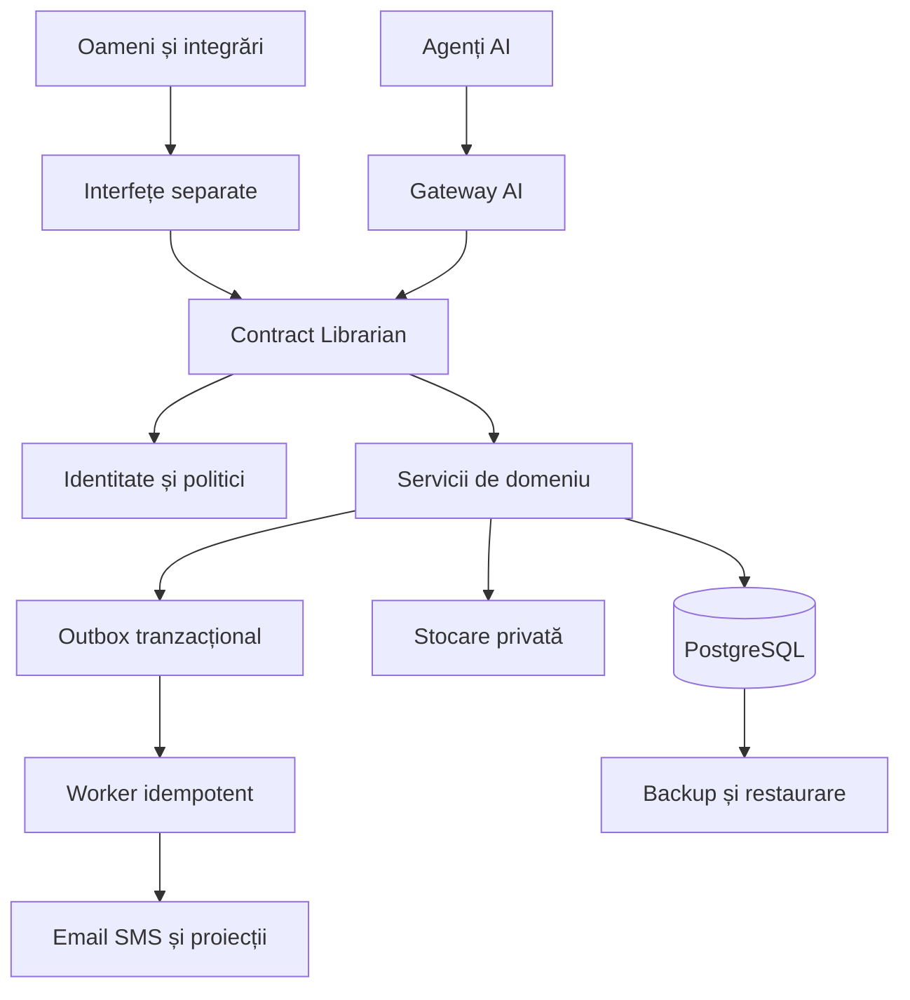

# 01 — Arhitectura generală PUII MEI
Versiune 0.1 — 24.11.2026 — DRAFT pentru reconciliere. CONFIRMAT = cerință fondator; PROPUS = proiectare; DESCHIS = decizie necesară. Nu autorizează implementarea comercială.

## 1. Mandat și inventar
CONFIRMAT: gospodăriile sunt producători independenți; platforma coordonează în limitele mandatului. Admin este centrul operațional, website-ul separat. Plățile clienților direct către gospodării; ADR-001: comision 10% din profitul pozitiv pe ciclu închis; definițiile contabile rămân deschise. Compliance Gate obligatoriu.
Referințe: 00-FOUNDER-TECHNICAL-REQUIREMENTS.md (PR58), constituția, ADR-001, NAV-001 (PR62), AUD-001 (PR63), schema draft PR60. PR65–70 și 73 sunt propuneri de cod neintegrate la ultima verificare. Review Librarian: PR62 comentariile 7141287353 și 7143832781. Nu confundăm starea branch-urilor cu producția.
AS-BUILT: Next.js/TypeScript, PostgreSQL cu documente JSONB, repository-uri și server actions; PR70 propune atomicitate și audit; PR73 propune navigare Admin. Auditul complet al importurilor și rutelor rămâne de efectuat.

## 2. Context și limite

PROPUS: monolit modular, bibliotecar logic, fără hop de rețea obligatoriu. Catalog tipizat în cod, nu registru runtime duplicat. Nici UI, nici AI nu primesc credențiale DB. Accesul tehnic privilegiat pentru migrare/restore este separat și auditat. Admin nu este superuser SQL.

## 3. Contractul dintre componente
PROPUS: AccessContext derivat server-side: principalId, actorType, sessionId, workspace, membershipId, mandateId, scope, requestId; niciun câmp de autoritate nu este acceptat nevalidat de la client.
query(name, input, ctx) -> proiecție explicită autorizată; command(name, input, ctx, idempotencyKey, expectedVersion?) -> rezultat sau eroare tipizată. Handlerul domeniului deține invarianta; mediatorul subțire nu conține reguli de business. Repository-urile sunt interne domeniului; acces cross-domain prin contract public tipizat. Importurile interzise se verifică în CI. PostgreSQL RLS și constrângeri constituie apărare suplimentară, nu substitut pentru autorizarea obiectului/câmpului.
Erori comune: UNAUTHENTICATED, FORBIDDEN, NOT_FOUND (fără dezvăluirea existenței obiectelor neautorizate), VALIDATION_FAILED, CONFLICT, COMPLIANCE_HOLD, TEMPORARILY_UNAVAILABLE. Retry doar pentru operațiuni idempotente.

## 4. Domenii și proprietatea datelor
| Domeniu | Date deținute | Contract public propus |
|---|---|---|
| Identity | principal, membership, mandat | authorize, revoke |
| Household | profil, capacitate fizică | getHousehold, registerHousehold |
| Production | lot, țarc, evenimente | allocate, recordMortality |
| Commerce | comandă, ofertă, contract comercial | placeOrder, cancelOrder |
| Finance | încasări, cheltuieli, decont | recordPayment, closeCycle |
| Compliance | document, verificare, hold | evaluateGate, approveEvidence |
| Logistics | stoc, transport, predare | scheduleDelivery, confirmHandover |
| Traceability | legături de proveniență | getAuthorizedHistory |
| Platform | audit, outbox, fișiere | appendAudit, enqueue, authorizeFile |
| Intelligence | agent, run, proposal | proposeAction |
Datele globale nu primesc artificial household_id; datele tenant-scoped folosesc chei compuse și politici. Proiecțiile nu devin surse independente de adevăr.

## 5. Fluxuri și consistență
Citire: autentificare → autorizare scope → query indexat și paginat → proiecție allowlist → răspuns. Cache cheiat pe scope și versiunea politicii; revocarea invalidează accesul, nu doar meniul.
Scriere: autentificare → validare input → tranzacție → autorizare contextuală și verificare versiune/hold → modificare + audit + outbox → commit → răspuns → worker. Efectele externe nu rulează în tranzacție. Idempotency key asociată actorului și operațiunii; reutilizare cu payload diferit = conflict. Tranzacțiile cross-domain au ordine de lock documentată și retry limitat; nu se aprobă operațiuni financiare prin cache.
Offline propus numai pentru observații de producție: UUID client, stare locală/pending/accepted/rejected, revalidare la sincronizare; nu promite salvare centrală înainte de confirmare. Rezervări, plăți și aprobări online.
Audit append-only, identitate reală, corecții explicite; fără secrete. Partiționarea lanțurilor și ancorarea externă sunt deschise până la demonstrarea integrității.

## 6. NFR și recuperare
Ipoteză de dimensionare Claude: 50k gospodării, 2–5M comenzi/an, 500k observații/zi, 100–200M audit/an. Nu prognoză. Ținte p95 propuse pe server warm: citire simplă 50ms, complexă 150ms, scriere 200ms, dashboard 300ms. Măsurăm p50/p95/p99, throughput, erori, pool wait, lock wait, query bytes, cold starts separat, la 10/100/500 utilizatori concurenți cu dataset declarat. Nicio garanție fără benchmark.
RPO/RTO per incident și buget DESCHIS. Backup zilnic extern implică RPO până la 24h; PITR nu garantează recuperarea selectivă fără pierderea scrierilor valide. Restore izolat, verificare FK, audit, obiecte și reconciliere; nu restaura peste producție automat. Replici pentru citiri tolerante la lag, nu autorizare critică. Furnizor, retenție și rezidență deschise.

## 7. Acceptanță
ARCH-T01: test static interzice import DB din UI și AI.
ARCH-T02: aceeași comandă are proiecții diferite autorizate; acces cross-tenant refuzat inclusiv cache.
ARCH-T03: rollback la eșec audit/outbox; niciun email înainte de commit.
ARCH-T04: două rezervări concurente nu depășesc capacitatea.
ARCH-T05: revocare mandat blochează comenzi și abonamente.
ARCH-T06: nou modul înregistrat fără modificarea logicii domeniilor existente, exceptând integrarea explicită.
ARCH-T07: restore izolat cu verificarea integrității și timp măsurat.
ARCH-T08: benchmark reproductibil înainte de aprobarea SLO.
Toate sunt criterii propuse, nu rezultate executate.

## 8. Index canonic al celor 20 capitole
Numerotarea urmează mandatul original, nu numerotarea istorică a fișierelor draft.
| Nr | Capitol | Stare / referință |
|---|---|---|
|01|Arhitectura generală|acest draft|
|02|Arhitectura aplicațiilor|următorul draft; NAV-001/PR73|
|03|Baza de date|PR60, fișiere CHATGPT-04-* istorice; DDL netestat|
|04|Utilizatori și permisiuni|de redactat|
|05|Gospodărie|de redactat|
|06|Producție|de redactat|
|07|Comercial|de redactat|
|08|Trasabilitate|de redactat|
|09|Financiar|de redactat|
|10|Logistică|de redactat|
|11|Calitate și conformitate|de redactat|
|12|Agenți AI|de redactat|
|13|API și comunicare|de redactat; OpenAPI necesar|
|14|Arhitectura tehnică|de redactat|
|15|Securitate|de redactat; AUD-001|
|16|UX|de redactat; NAV-001|
|17|Infrastructură și deployment|de redactat|
|18|Testare|de redactat|
|19|Extindere|de redactat|
|20|Plan implementare|de redactat|
Fiecare capitol: inventar verificat, contracte, date, permisiuni, fluxuri, erori, teste, decizii deschise. Reconciliere cu Claude și ADR înainte de baseline. Niciun capitol nu este declarat finalizat doar pentru existența fișierului.

## Addendum v0.2 — Consulta
Decizii fondator transmise de Claude în PR62, comentarii 7144648431 și 7144750950: ierarhie gospodar → manager local (o comună/UAT) → manager zonal (comunele circumscripției unei judecătorii) → admin național; notificare zilnică sarcini și programări; justificare pe fiecare sarcină, notificare local, vizibilitate zonal și admin; automatizare AI maximă. PROPUS: domeniu Operations/Tasks, nomenclator teritorial versionat, atribuiri temporale, outbox. SLA, termene escaladare, lista aprobărilor umane AI și buget E0 DESCHISE. Main verificat: pg-store.ts încă list integral, pool max3; PR65–68 închise, MFA prezent în main; PR69/70/73 deschise. Nu deducem merge doar din closed. Citirile țintite sunt următorul pas anunțat Claude, nu livrat verificat.
