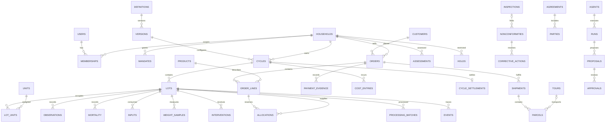

# 03 — Arhitectura bazei de date
v0.1 / DRAFT / 24.11.2026. Numerotare conform mandatului PR58. Referințele istorice CHATGPT-04-* din PR60 sunt anexe normative candidate, nu migrații aprobate. CONFIRMAT: gospodării independente, mandat, plăți directe, ADR-001, compliance gate. PROPUS: schema relațională PostgreSQL 16, Librarian contract. DESCHIS: model juridic detaliat, IAM, fiscalitate, retenție, infrastructură.
## 1. Inventar verificat
Am recitit integral cele trei SQL din branch docs/chatgpt-database-architecture-v1: chatgpt-04-core-schema.draft.sql, chatgpt-04-extensions.draft.sql, chatgpt-04-tenant-hardening.draft.sql. Primele două definesc 53 tabele în 15 scheme; al treilea adaugă constrângeri și politici, nu tabele. Aceste fișiere conțin câmpurile, tipurile, PK/FK, CHECK, UNIQUE și indexurile existente în draft. Nu sunt executate în PostgreSQL. Nu reprezintă schema completă finală. PR60 mai conține contracte tranzacționale și scenarii TEN-01..12. Claude PR55 are o schemă alternativă; reconcilierea completă rămâne necesară. As-built cunoscut: documents JSONB; audit PR70 și storage PR65 sunt propuneri de integrare, nu presupunem că sunt în producție.
## 2. Catalogul arhivei
| Schemă | Tabele existente în DDL candidat | Clasificare |
|---|---|---|
|identity|users, memberships|restricționat/global și tenant|
|household|households, mandates|tenant|
|programs|definitions, versions, cycles|catalog global și cicluri tenant|
|production|lots, observations, inputs, units, lot_units, mortality, weight_samples, interventions|tenant|
|commerce|customers, products, orders, order_lines, allocations|clienți restricționați, catalog global, comenzi tenant|
|finance|bank_accounts, payment_evidence, cost_entries, cycle_settlements|tenant sensibil|
|compliance|requirements, assessments, holds|catalog și tenant|
|logistics|shipments, processors, processing_batches, tours, parcels, temperature_readings|catalog și tenant|
|traceability|events|tenant, proiecții publice distincte|
|platform|documents, audit_events, outbox, idempotency_keys|scope explicit, restricționat|
|contracts|agreements, parties|tenant și participanți|
|inventory|suppliers, items, stock_locations, stock_movements|catalog și tenant|
|quality|inspections, nonconformities, corrective_actions|tenant|
|notifications|templates, deliveries|catalog și scope destinatar|
|ai|agents, runs, proposals, approvals|global/tenant explicit|
## 3. ERD logic (relații principale; DDL anexat conține coloanele)

ERD simplificat: nu implică relații FK inexistente; documentele, auditul și actorii au referințe suplimentare în SQL.
## 4. Convenții și integritate
UUID intern, număr comandă/slug public distinct, fără token secret în URL Admin. timestamptz UTC, date pentru zi locală Europe/Bucharest; numeric exact pentru bani și cantități, unitate și monedă explicite. JSONB numai reguli versionate, payload evenimente și extensii validate; nu ascunde FK sau sume în JSONB. Chei tenant compuse (id,household_id), NOT NULL pentru scope obligatoriu, fără CASCADE pe istoric financiar/juridic. Status CHECK nu dovedește tranziție validă: handlerul și tranzacția verifică starea, versiunea și actorul. Corecții prin eveniment/reversare, nu suprascriere istorică. Fișiere private în object storage, metadate/hash în DB; upload staged, verificare, atașare, garbage collection după reconciliere.
## 5. Defecte concrete identificate în SQL candidat
| ID | Constatare din DDL | Remediere propusă / gate |
|---|---|---|
|DB-G01 P0|document_id/evidence_id referă doar documents.id în mandate, assessments, holds, inputs, finance, contracts, inventory, quality, logistics, trace|FK compus pentru document tenant; document global numai prin tip de legătură explicit|
|DB-G02 P0|payment_evidence.bank_account_id FK simplu|FK compus cont/tenant; păstrare cont activ la momentul instrucțiunii|
|DB-G03 P0|ai.proposals.household_id nullable, MATCH SIMPLE permite bypass FK compus; approvals fără scope|scope explicit global/tenant, verificare egalitate null-safe, autorizare prin run și proposal|
|DB-G04 P0|reserved_units CHECK nu impune suma allocations active; lot_units fără capacitate rezervată pe țarc|registru alocări pe unitate/lot și tranzacție cu lock; reconciliere și test concurent|
|DB-G05 P0|RLS numai 28 tabele (8 core +20 hardening), fără FORCE; documente, customers, AI, notificări și alte tabele neacoperite|rol runtime non-owner/NOBYPASSRLS, FORCE unde aplicabil, politici pe fiecare tabel și scope multi-tenant; test pool|
|DB-G06 P0|audit_events fără actorType, lanț, protecție append-only, outcome; outbox fără lease/dead letter|reconciliere AUD-001/PR70; EVT-001, atomicitate, ancorare verificabilă|
|DB-G07 P1|agreements UNIQUE(household_id,agreement_type,version) poate bloca contracte distincte de același tip; parties polimorf fără FK|identitate contract + versiuni + participanți tipizați; legătură explicită comandă|
|DB-G08 P1|cycle_settlements UNIQUE(cycle_id) împiedică versiuni istorice; lipsă currency, snapshot și legături la intrări|decont versiuni, aprobare și reversare; fără automatizare fiscală neaprobată|
|DB-G09 P1|requirements code UNIQUE deși are version; assessments fără unicitate versiune|identitate cerință + versiune imutabilă, evidență aplicabilitate|
|DB-G10 P0|customers fără legătură identity.users; memberships role text liber; lipsă sesiuni, delegări, grants|capitol 04; identitate client, principal uman/AI/system, roluri și scope|
|DB-G11 P1|orders și order_lines currency pot diferi; allocations units integer vs quantity numeric fără conversie explicită|unități program versionate, monedă coerentă, ofertă și preț snapshot|
|DB-G12 P1|stock_movements fără balanță atomică sau legătură transfer; stock_locations global nullable|model central separat, balanță și lock pe item/location, transfer pereche|
|DB-G13 P1|temperature_readings poate referi parcel și tour diferite din același tenant|verificare relație parcel-tour; reguli măsurare validate|
|DB-G14 P1|iban_ciphertext fără key_id; fingerprint fără specificație HMAC; lipsă workflow MFA/24h|reconciliere ADR009/PR61/68; chei separate, rotație și istoric|
|DB-G15 P1|notifications.event_key UNIQUE poate împiedica mai mulți destinatari/canale dacă este cheia evenimentului|unicitate event+recipient+channel+template version|
|DB-G16 P1|observations/mortality fără client event id, corecții sau efectiv inițial verificabil|evenimente idempotente, efectiv inițial și corecții, validare offline|
|DB-G17 P1|tours și orders au un singur household_id|nu presupunem tură/comandă multi-gospodărie; decizie fondator înainte de remodelare|
Constatările sunt review static, nu vulnerabilități demonstrate în producție. DDL v0.3 confirmă existența coloanelor folosite de politicile observations, inputs, settlements și trace. Nu am executat sintaxa EXCLUDE sau politicile.
## 6. Contracte tranzacționale
AllocateOrderLine: lock lot și unități în ordine stabilă, verifică mandat/hold, capacitate și unități, inserează alocare, actualizează registru, audit/outbox în aceeași tranzacție. Cancel eliberează exact o dată. RecordProductionEvent: deduplicare client UUID, lock lot, verifică efectiv disponibil, append event, actualizează proiecție. RequestBankChange: păstrează activ contul vechi până la verificări aprobate; MFA și termen conform ADR, nu inventa bypass. CloseCycle: lock ciclu, verifică intrări reconciliate și versiunea regulii; fee 10% din profit pozitiv, calcul final blocat până la definiții aprobate. ReleaseComplianceHold: verifică dovezi aprobate, autoritate și versiune; upload singur nu eliberează hold. Toate: idempotency scope actor+command, hash input, conflict la reutilizare diferită, retry limitat la deadlock/serialization, audit/outbox atomic, efect extern după commit.
## 7. Indexare și volum
Indexurile existente în DDL sunt punct de pornire. Propuneri de verificat EXPLAIN ANALYZE pe dataset sintetic: orders(household_id,created_at DESC,id), lots(household_id,status,id), observations(lot_id,observed_on DESC,id), allocations(lot_id,status), assessments(household_id,status,expires_at), audit(household_id,occurred_at DESC,id), outbox(available_at,id) WHERE pending. Index FK pe căi frecvente; nu indexa automat orice coloană. Cursor stabil (timestamp,id), filtre pushdown, proiecții selectate. Audit/observații voluminoase: partiționare lunară propusă numai după benchmark; PK/UNIQUE trebuie să includă cheia partiției sau registru global separat, FK și deduplicare reproiectate înainte. Read models reconstruibile cu watermark și asOf; autorizarea critică pe primary. Nicio estimare p95 nu este măsurată.
## 8. Migrare JSONB → relațional
M0 inventar exact collections, chei, volume, forme JSON, orfani, duplicate, PII, mapping sursă→țintă; export consistent și hash. M1 schema validată în PG16 disposable, roluri și test concurență; backup restaurat. M2 backfill idempotent cu tabel mapping legacy_collection+legacy_id→uuid, batch/checkpoint, carantină erori fără pierdere; nu inventa valori lipsă. M3 reconciliere counts, sume pe monedă/tenant, capacitate, FK, document hash și contracte; diferențe explicate. M4 shadow reads și comparații autorizate; scriere unică autoritativă, replicare prin outbox/CDC dacă necesar, fără dual-write neatomic. M5 cutover controlat cu fereastră de oprire scrieri sau protocol de catch-up verificat, watermark, verificare și aprobare. M6 rollback plan: păstrare sursă read-only, captură scrieri post-cutover, replay invers validat sau forward fix; nu restaura orb snapshot vechi. M7 eliminare legacy numai după retenție aprobată și restore test. DDL v0.3 NOT NULL fără backfill este strict pentru DB goală.
## 9. Izolare și recuperare
SET LOCAL scope numai în tranzacție, din context server verificat; niciun rol client nu poate seta arbitrar context SQL. Manager multi-tenant prin grant explicit, nu bypass RLS. Customer access prin ownership și proiecție, nu acces la întreg tenant. Test rol runtime, owner, worker, backup, revocare, conexiune reutilizată. Backup criptat DB+object storage, manifest versiuni și hash, PITR și restore izolat; RPO/RTO și retenție deschise. Ștergere GDPR evaluată per categorie, pseudonimizare și legal hold, fără promisiunea ștergerii imediate din backup.
## 10. Gate de validare
DB-T01 aplicare core→extensions→hardening în PG16 gol, catalog verificat; DB-T02 toate FK cross-tenant negative inclusiv document și IBAN; DB-T03 RLS rol real și pool reuse; DB-T04 100 cereri concurente pentru 40 locuri fără overbooking; DB-T05 retry și rollback business/audit/outbox; DB-T06 lot_units overlap; DB-T07 AI null-scope bypass refuzat; DB-T08 contracte multiple și decont versionat; DB-T09 migrare dataset sintetic cu orfani și duplicate; DB-T10 restore DB+fișiere; DB-T11 benchmark p50/p95/p99 cu volum declarat; DB-T12 reconciliere cu Claude tabel/coloană/invariant. Niciun test nu a fost executat în această etapă.
## 11. Livrabile rămase
Schema canonică SQL reconciliată, dicționar complet per coloană (clasificare, proprietar, unitate, retenție), ERD fizic complet, mapping legacy real, matrice RLS executabilă, migration scripts și rezultate PG16. Nu declara capitolul final până la închiderea P0 și deciziilor relevante. Nu aplica SQL în producție.
