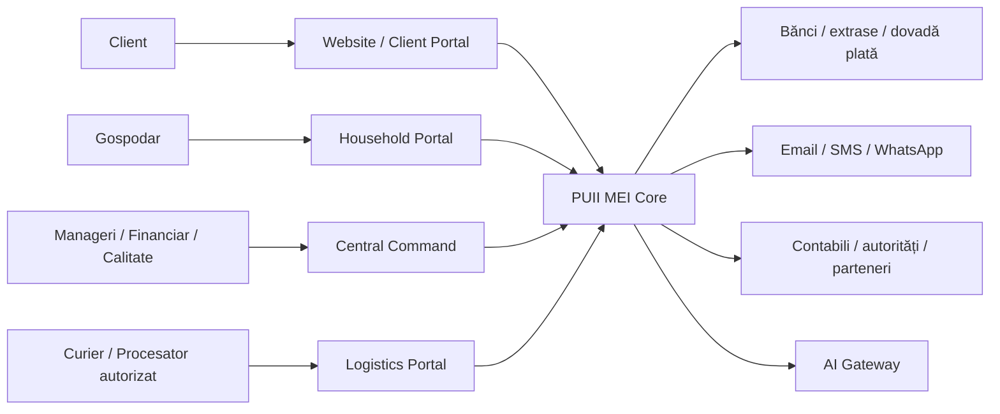
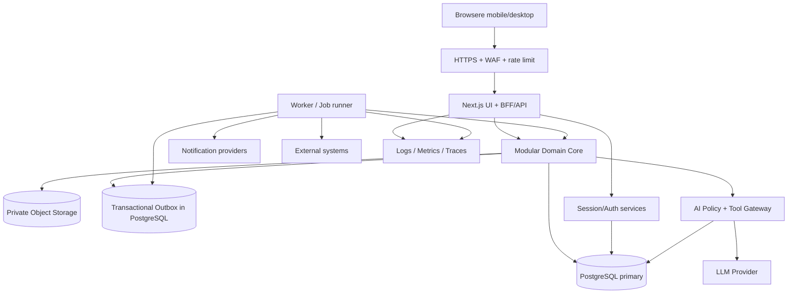

# CHATGPT — 03 SYSTEM ARCHITECTURE — PUII MEI

**Versiune:** 0.1 DRAFT · **Autor:** ChatGPT · **Data:** 2026-11-23  
**Status:** specificație propusă pentru review; fără implementare sau aprobare de producție.  
**Bază citită:** `00-SYSTEM-CONSTITUTION.md`, `MASTER-TECHNICAL-SPECIFICATION.md`, `README.md`, `plan-platforma.md`, `src/lib/domain.ts`, `src/server/db/{store,pg-store,pg-ssl,json-store}.ts`, `src/server/session-token.ts`, `src/server/order-access.ts`, `prisma/schema.prisma`. ADR-001 despre 10% este raportat ca merged de fondator, dar calea/versiunea nu a fost identificată prin fetch; regula este marcată ca **confirmată verbal, de reconciliat cu ADR**.

## 1. Principii, limitări, clasificări

**[C] Confirmat ca cerință de produs:** gospodăriile produc și vând independent; PUII MEI coordonează în limitele mandatelor; plățile clienților merg la gospodărie; există Central Command, interfețe specializate, precomenzi, trasabilitate, raportare și agenți AI sub control uman.  
**[P] Propunere arhitecturală:** modular monolith Next.js/TypeScript, PostgreSQL relațional, procesare asincronă cu outbox, object storage privat, permisiuni pe obiect și tenant.  
**[D] Decizie deschisă:** model contractual tripartit și obligații legale exacte; bancă/mandat și confirmare încasări; procesare și transport autorizate; identitatea producătorului pe documentele fiscale; schema de costuri standard, diferențele față de realitate, FCR și avansul; rolul investitorilor.

### Invariante de sistem (propuneri care devin obligatorii doar după aprobare)

- **SYS-INV-01:** niciun lot comercial activ fără Compliance Gate aprobat de un operator competent.
- **SYS-INV-02:** orice mutație de domeniu este autorizată server-side pe actor, acțiune, resursă, gospodărie și mandat.
- **SYS-INV-03:** capacitatea disponibilă = capacitate autorizată − rezervări active − angajamente; nu poate deveni negativă prin concurență.
- **SYS-INV-04:** confirmarea declarativă a unei plăți nu este echivalentă cu încasarea bancară verificată.
- **SYS-INV-05:** PUII MEI nu este automat titularul vânzării, deținătorul produselor sau al banilor.
- **SYS-INV-06:** loturile, comenzile, cheltuielile și contractele au versiuni de regulă/contract/tarif; schimbările ulterioare nu rescriu istoricul.
- **SYS-INV-07:** nicio acțiune AI nu poate eluda autorizarea, tranzacțiile, auditul sau aprobările umane.
- **SYS-INV-08:** orice operațiune financiară, contractuală sau de siguranță alimentară cu impact real este executată numai după validarea autorității persoanei responsabile.
- **SYS-INV-09:** Central Command este o proiecție și un orchestrator, nu o a doua bază de date independentă.
- **SYS-INV-10:** toate sumele sunt DECIMAL sau unități minore întregi; niciodată floating point pentru bani.

## 2. C4 — Context (nivel 1)

**Trust boundaries:** utilizatori publici → edge/WAF → API; operatori interni → autentificare MFA → API; parteneri externi → integrare limitată; AI → tool gateway cu aprobare; aplicație → DB/storage private. Serviciile externe nu primesc acces direct la DB.

## 3. C4 — Containere și deployment logic (nivel 2)

**Deployment [P]:** un deploy web + un worker independent pentru jobs, ambele din același repo și aceleași module de domeniu. PostgreSQL administrat, storage privat, CDN pentru asset-uri publice. Worker separat nu implică microserviciu de business. Dacă hostingul este exclusiv serverless, se validează suportul pentru jobs durabile înainte de alegerea furnizorului.

## 4. C4 — Componente interne și ownership (nivel 3)

| Domeniu | Proprietar de date | Operațiuni exclusive | Evenimente publicate |
|---|---|---|---|
| Identity & Access | users, identities, memberships, sessions, grants | login, revocare, autorizație | UserDisabled, RoleChanged |
| Household OS | farms, mandates, compliance dossiers | onboarding, profil, mandat, activare | FarmVerified, MandateRevoked |
| Program Engine | program_definitions, program_versions, recipes, budgets | rețetă, cost standard, eligibilitate | ProgramVersionApproved |
| Production | production_batches, pens, flock_movements, observations | planificare, intrări, mortalitate, greutăți | BatchStarted, MortalityRecorded |
| Inventory | inventory_items, movements, receipts | aprovizionare, recepție, consum | StockReceived, StockConsumed |
| Commercial | orders, order_items, reservations, allocations | precomandă, rezervare, anulare | OrderPlaced, CapacityReserved |
| Contracts | contract_templates, contract_versions, signatures | redactare, aprobare, semnare | ContractActivated |
| Finance | receivables, payment_claims, reconciliations, cost_ledger, fee_statements | evidență, reconciliere, calcul onorariu | PaymentReconciled, FeeStatementApproved |
| Quality | inspections, nonconformities, corrective_actions, holds | inspecție, blocare/deblocare | LotHeld, HoldReleased |
| Traceability | trace_events, provenance_links | genealogie produs, interogare lanț | TraceEvidenceAttached |
| Logistics | shipments, packages, tours, delivery_events | plan, ridicare, transport, predare | PackageDelivered |
| Documents | document_metadata, document_access | upload, scan, retenție, autorizare | DocumentVerified |
| Notifications | templates, deliveries, preferences | trimitere, retry, unsubscribe | NotificationSent |
| AI Orchestration | agent_runs, tool_calls, approval_requests | propuneri, execuție aprobată | AgentActionProposed |

**Regula de ownership:** un modul nu scrie tabelele altui modul direct. Interacțiunea este prin porturi interne tipizate; citirea transversală pentru rapoarte se face prin query/read-model autorizat. Excepțiile tranzacționale sunt orchestrate de application services, nu prin apeluri HTTP între module ale aceluiași proces.

## 5. Contracte între module

**Porturi [P]**: `Identity.authorize(ctx, action, resource)`; `Households.requireActiveMandate(farmId, scope, at)`; `Compliance.assertProgramAllowed(farmId, programVersionId)`; `Production.reserveCapacity(batchId, count, orderId)`; `Commercial.placePreorder(command, idempotencyKey)`; `Finance.recordPaymentEvidence(orderId, evidence)`; `Finance.reconcileReceipt(receiptId, verifier)`; `Quality.placeHold(batchId, reason)`; `Traceability.getCustomerView(orderId, principal)`; `AI.proposeAction(actor, tool, args)`.

Fiecare comandă returnează `{id, version, status}` ori eroare tipizată; include `actorId`, `tenantId` când este relevant, `correlationId`, `idempotencyKey` la mutații externe, `expectedVersion` pentru actualizări concurente.

**API convenție [P]:** `/api/v1/*`, JSON, validare Zod la graniță, OpenAPI 3.1 generat/verificat, RFC 9457 Problem Details la erori, `X-Request-ID` și `Idempotency-Key` pentru operațiuni de creare/plată/alocare. Nu se expun ID-uri sau documente între gospodării doar prin cunoașterea URL-ului.

## 6. Tranzacții și concurență

**Exemplu rezervare [P]:** (1) autentificare; (2) mandat și Compliance Gate; (3) begin DB transaction; (4) lock rând de capacitate / `SELECT ... FOR UPDATE`; (5) verifică `available >= requested`; (6) creează order + reservation + audit + outbox; (7) commit; (8) worker trimite confirmarea. Retry cu aceeași cheie întoarce același rezultat, fără a dubla rezervarea.

**Exemplu încasare [P]:** declarația clientului → `payment_claimed`; extras/dovadă verificată de beneficiar/mandatar autorizat → `payment_verified`; reconciliere unică după referință, beneficiar, sumă și dată; diferențele → `reconciliation_exception`. Nicio trecere automată la `verified` dintr-un simplu click al clientului.

**Outbox [P]:** evenimentul se scrie în aceeași tranzacție cu agregatul; worker-ul îl revendică cu lock, livrează at-least-once; consumer-ul deduplică după `event_id`; retry exponential + jitter, dead-letter după limită, reprocess manual auditat. Evenimentele nu sunt folosite pentru a evita tranzacțiile necesare.

## 7. Securitate și confidențialitate

- Identitate: conturi individuale; roluri globale + membership pe gospodărie; MFA pentru administratori/financiar și aprobări critice [P].
- Autorizare: `authorize(principal, action, resource, tenant, mandate)` în application service; deny-by-default, inclusiv server actions, downloads și joburi.
- Sesiuni: cookie `httpOnly`, `Secure`, `SameSite`; invalidare după dezactivare/rotire; CSRF pentru mutații; rate limit distribuit pentru login/PIN; reset cu token de unică folosință.
- Documente: storage privat, scan malware, allowlist MIME + validare magic bytes, checksum SHA-256, URLs semnate scurt, jurnal descărcări, retenție per categorie.
- Date: criptare TLS verificată, backup criptat, secrete prin manager, PII redus în loguri; separarea gospodăriilor prin politici de query + RLS evaluat ca defense-in-depth [P].
- Audit: append-only logic, actor/mandat/tenant, înainte/după doar pentru câmpuri permise, corelare, tamper-evidence și retenție aprobată. Nu promitem imutabilitate absolută a unui simplu tabel DB.
- GDPR: registru prelucrări, temeiuri, retenție, DSAR, export, ștergere/anonymizare unde permis, DPIA dacă analiza riscului o cere.

## 8. Observabilitate, fiabilitate, performanță

**Propuneri de SLO, de validat:** disponibilitate 99,5% MVP, p95 API read <500 ms și write <1000 ms în condiții de încărcare convenite; RPO <=24h, RTO <=8h la MVP numai dacă sunt susținute de backup/restore testate. Nu sunt promisiuni contractuale.

Metrice: rata 4xx/5xx, latență pe rută, saturare pool DB, coadă outbox, retry/dead-letter, rezervări concurente respinse, comenzi nealocate, încasări nereconciliate, documente expirate, loturi blocate, acțiuni AI în așteptare. Alertare cu owner și runbook. Logurile conțin `correlationId`, `tenantId` pseudonimizat, `actorId`, `eventId`, fără tokenuri, PIN sau IBAN complet.

## 9. Erori standard

| Cod | HTTP | Condiție | Reacție |
|---|---:|---|---|
| AUTH_REQUIRED | 401 | sesiune lipsă | autentificare |
| ACCESS_DENIED | 403 | rol/mandat/tenant nevalid | audit refuz |
| RESOURCE_NOT_FOUND | 404 | resursă absentă sau ascunsă | răspuns fără divulgare |
| VERSION_CONFLICT | 409 | `expectedVersion` diferit | refresh/retry |
| CAPACITY_EXCEEDED | 409 | rezervare peste disponibil | alternativă/așteptare |
| COMPLIANCE_BLOCKED | 409 | program neeligibil | escaladare conformitate |
| INVALID_INPUT | 422 | schema invalidă | erori pe câmpuri |
| IDEMPOTENCY_CONFLICT | 409 | aceeași cheie, payload diferit | respingere |
| RATE_LIMITED | 429 | prag depășit | Retry-After |
| DEPENDENCY_UNAVAILABLE | 503 | DB/storage/provider indisponibil | retry sigur / fără side effects |

## 10. Decizii arhitecturale propuse (ADR backlog)

- ADR-TECH-001 modular monolith și limite domenii.
- ADR-TECH-002 PostgreSQL relațional, ORM/query layer și tranzacții.
- ADR-TECH-003 model multi-tenant (membership, scope, RLS).
- ADR-TECH-004 outbox/worker și idempotency.
- ADR-TECH-005 object storage, document security și retention.
- ADR-TECH-006 AI tool gateway, approvals și audit.
- ADR-TECH-007 contract API și versionare.
- ADR-TECH-008 migrare JSONB, dual-read/dual-write doar dacă este justificat și verificat.
- ADR-TECH-009 identitate și acces curieri/clienți, înlocuirea PIN-urilor manuale.
- ADR-TECH-010 versionare rețete/cost standard și reconciliere diferențe reale.

## 11. Criterii de acceptanță ale specificației SYS

- **SYS-AC-01:** diagramele C4 au corespondență cu modulele și sursele de adevăr; niciun modul nu deține implicit datele altuia.
- **SYS-AC-02:** fiecare comandă critică are tranzacție, idempotency și rezultat la retry documentate.
- **SYS-AC-03:** fiecare operațiune are o politică actor+resursă+gospodărie+mandat; testele negative sunt obligatorii.
- **SYS-AC-04:** fiecare integrare externă are timeout, retry, fallback și proprietar operațional.
- **SYS-AC-05:** fiecare eveniment are producător, schemă, versiune, consumer, idempotency și retenție.
- **SYS-AC-06:** orice diferență dintre codul existent și ținta arhitecturală este documentată ca migrare, nu ascunsă.
- **SYS-AC-07:** niciun flux financiar nu presupune că PUII MEI încasează banii clientului.
- **SYS-AC-08:** nicio funcție AI nu poate executa plăți, contracte sau deblocări de calitate fără aprobarea și autoritatea umană potrivită.

## 12. Riscuri și blocaje

**P0 actual verificat în cod:** `store.ts` permite fallback JSON/`/tmp` în lipsa URL DB; `pg-store.ts` este un store generic JSONB fără interfață de tranzacții multi-entitate; `prisma/schema.prisma` este neconectată. **Îmbunătățiri observate:** `pg-ssl.ts` setează `rejectUnauthorized:true` pentru hosturi nonlocale; `session-token.ts` cere secret în producție. Nu s-au executat teste. `order-access.ts` păstrează temporar PIN manual în modelul comenzii când SMS/email nu sunt disponibile; necesită threat model și eliminarea accesului manual înainte de scalare.

**Blocaje de produs:** documentul ADR-001 trebuie localizat și reconciliat; modelul financiar 10% și costurile standard trebuie versionate, fără a confunda calculul contractual cu profitul fiscal; ipoteza 9,8 kg furaj/pasăre nu poate fi tratată drept randament zootehnic validat; condițiile de sacrificare și distribuție trebuie confirmate de specialiști.

**Următoarea specificație:** `CHATGPT-04-DATABASE-ARCHITECTURE.md` cu DDL, ERD, indecși, invarianti, politici tenant și plan de migrare; aceasta nu este încă inclusă aici.
