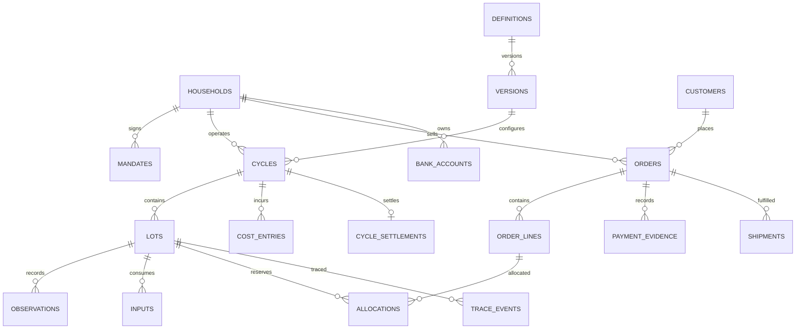

# CHATGPT-04 — Arhitectura bazei de date PUII MEI

**Versiune:** 0.1 · **Statut:** DRAFT / design independent, neaprobat pentru implementare · **Data:** 2026-11-23  
**Artefact asociat:** `chatgpt-04-core-schema.draft.sql` (PostgreSQL 16; nu este migrare de producție).  
**Avertisment:** nu am executat DDL-ul într-un PostgreSQL și nu afirm că schema compilează. Aceasta este **prima tranșă executabilă a nucleului**, nu inventarul final al tuturor modulelor.

## 1. Audit și surse inspectate

- `src/lib/domain.ts` — tipuri curente `Farm`, `Lot`, `Preorder`, `FarmPaymentDetails`, `Parcel`, `Tour`, `FeedPayment`; stări și câmpuri existente.
- `src/server/db/pg-store.ts` — tabel generic `documents(collection,id,data jsonb,created_at)`, `transact` cu `SELECT FOR UPDATE` pe document, pool maxim 3; nu oferă tranzacții cross-collection.
- `00-SYSTEM-CONSTITUTION.md` — SC-001…SC-005 și SC-040…SC-043; gospodăria independentă, platforma coordonator, bani direct la gospodărie.
- `adr/ADR-001-ONORARIU-PUII-MEI.md` — 10% × max(0, venituri−cheltuieli) pe ciclu închis, bază contabilă deschisă; **nu implementăm calculul**.
- `CLAUDE-02-SYSTEM-AND-DATABASE-ARCHITECTURE.md` — doar secțiunile introductive consultate pentru context; designul de mai jos este independent, nu copierea celor 77 tabele Claude.
- PR #56 și #59 — remediere PIN integrată, rezervare atomică în curs de merge; schema noastră NU presupune că migrarea lor este completă.

### As-built vs target

| Subiect | AS-BUILT confirmat | TARGET propus |
|---|---|---|
| Persistență | JSONB generic `documents` | PostgreSQL relațional, scheme pe domenii |
| Atomicitate | `transact(collection,id)` pe un document | tranzacții multi-entitate și constrângeri SQL |
| Model | `Farm` și `Lot` orientate inițial spre păsări | `household -> program -> cycle -> lot`, reguli versionate |
| Plăți | `FeedPayment` declarată/confirmată | dovezi + reconciliere bancară, fără confundarea declarației cu încasarea |
| IBAN | `FarmPaymentDetails` | cerere/verificare/activare separată, fără publicare prematură |
| Acces | roluri și tokenuri din codul curent | RBAC/ABAC + tenant RLS + verificare mandat |

## 2. Model conceptual și limite de domeniu

**Decizie de arhitectură [PROPUS]:** `household` este granița de tenant, `program definition/version` este granița de extensibilitate, `cycle` este granița de cost/închidere, `lot` este granița de producție/trasabilitate, `order line allocation` este granița de rezervare. Nu forțăm o comandă cu produse de la gospodării diferite într-o singură tranzacție comercială: împărțirea necesită subcomenzi și confirmare juridică.

## 3. Inventarul tabelelor DDL v0.1

| Schemă | Tabele | Responsabilitate |
|---|---|---|
| identity | users, memberships | identitate și apartenență |
| household | households, mandates | producător și mandat |
| programs | definitions, versions, cycles | programe reutilizabile și cicluri |
| production | lots, observations, inputs | capacitate, măsurători, consum |
| commerce | customers, products, orders, order_lines, allocations | vânzare directă și rezervare |
| finance | bank_accounts, payment_evidence, cost_entries, cycle_settlements | conturi, dovezi, costuri, închidere |
| compliance | requirements, assessments, holds | autorizări, verificări, opriri diferențiate |
| logistics | shipments | unitate inițială de livrare |
| traceability | events | evenimente cronologice lot |
| platform | documents, audit_events, outbox, idempotency_keys | fișiere, audit, evenimente și deduplicare |

**Total: 29 tabele în DDL-ul inițial.** Numărul este un inventar al textului propus, nu rezultatul unui test SQL. Nu sunt încă modelate complet: recepții/stocuri, furnizori, țarcuri individuale, intervenții veterinare, procesatori, ture/curieri/colete/temperaturi, documente fiscale, rambursări, dispute, AI jobs, notificări, granularitatea permisiunilor, ledger contabil și retenția GDPR. Acestea sunt **obligatorii pentru documentația finală** și nu trebuie omise din schema aprobată.

## 4. Invariante și tranzacții

**DB-INV-01 [PROPUS]** Nicio rezervare nu poate depăși capacitatea: `0 <= reserved_units <= capacity_units`. CHECK-ul protejează rândul lotului, dar nu garantează singur suma alocărilor. Comanda `allocate` trebuie să ruleze într-o **singură tranzacție**: blocare lot `FOR UPDATE`, validare `SUM(active allocations)`, inserare alocare, incrementare `reserved_units`, actualizare comandă, audit și outbox. Reîncercările folosesc cheie de idempotency. La anulare se eliberează în aceeași tranzacție. **Nu se poate implementa prin `pg-store.transact` actual**, care blochează doar un document.

**DB-INV-02 [PROPUS]** `household_id` al alocării trebuie să coincidă cu gospodăria lotului **și** a comenzii aferente liniei. DDL v0.1 verifică prima relație, **nu și a doua**; înainte de implementare, adăugăm `order_id,household_id` pe linie sau constrângere/trigger de integritate și test negativ. Nu acceptăm cross-tenant allocations.

**DB-INV-03 [PROPUS]** Plățile declarate nu sunt încasări bancare. Doar dovezi reconciliate de operator autorizat/integrare bancară validată pot trece în `verified`. Avansurile rămân în contul gospodăriei.

**DB-INV-04 [PROPUS]** Contul bancar nou nu poate deveni `active` fără verificare independentă, iar verificatorul trebuie să difere de solicitant. DDL acoperă separarea actorilor, dar **nu** tranzițiile, notificările, dovada verificării sau politica MFA; acestea sunt în lucru la Claude și necesită ADR.

**DB-INV-05 [CONFIRMAT + DESCHIS]** Onorariul PUII MEI este 10% din diferența pozitivă dintre venituri și cheltuieli, per ciclu închis. `cycle_settlements` stochează doar snapshoturi, fără calcul automat până la aprobarea definițiilor contabile.

**DB-INV-06 [PROPUS]** O restricție `compliance.holds` se aplică numai activităților declarate în `affected_actions`; severitatea și cauza trebuie validate extern. Blocarea trebuie verificată server-side la fiecare comandă relevantă.

**DB-INV-07 [PROPUS]** Datele istorice contractuale și financiare se păstrează versionat, cu audit append-only și documente imuabile logic; `UPDATE/DELETE` pe `audit_events` trebuie interzis prin roluri DB/triggere, încă nespecificat în DDL.

## 5. Multi-tenancy și autorizare

- Toate interogările de tenant rulează cu `SET LOCAL app.household_id = '<uuid>'` **în aceeași tranzacție** și sub rol SQL neprivilegiat, fără `BYPASSRLS`.
- DDL v0.1 definește RLS numai pe **8 tabele directe**: `mandates`, `cycles`, `lots`, `orders`, `cost_entries`, `payment_evidence`, `bank_accounts`, `shipments`. **Nu este acoperire completă și nu trebuie expus aplicației.**
- Tabelele indirecte (`order_lines`, `allocations`, `observations`, `inputs`, `traceability.events`, `compliance.assessments`, `compliance.holds`, `platform.documents`) au nevoie de RLS bazat pe `household_id` sau relații controlate; politicile se scriu și testează înainte de deploy.
- În plus față de RLS, fiecare comandă verifică actor, rol, tenant, obiect, mandat și Compliance Gate. Contextul de tenant nu poate proveni dintr-un header neautentificat.
- Rolurile de administrare cross-tenant au politici explicite, MFA, justificare, audit; nu folosesc în mod normal un cont DB superuser.

## 6. Migrare din JSONB — plan [PROPUS], fără execuție

1. Inventariere read-only a tuturor `collection` din `documents`; snapshot criptat, număr de rânduri, checksum, exemple anonimizate.
2. Mapare deterministă `Farm.slug -> household.id`, `Lot.code + farmSlug -> lot.id`, `Preorder.id -> order.id`; tabel de corespondență și raport de coliziuni.
3. Transformare într-un staging schema; validare FK, tipuri, referințe lipsă, date de stare, sume și capacități. Datele neconforme intră în carantină, nu se repară în tăcere.
4. Dry-run pe clonă izolată; comparare count/checksum pe fiecare colecție, totaluri bani, comenzi, păsări rezervate și colete.
5. Cutover cu înghețarea scrierilor sau mecanism dual-write/outbox proiectat explicit; niciodată schimbare implicită de storage.
6. Smoke E2E pe date anonimizate, plan de rollback cu praguri și RTO/RPO aprobate; reconciliere post-cutover.
7. Ștergerea JSONB vechi numai după retenție și aprobare explicită.

## 7. Matrice inițială de verificare

| ID | Test | Rezultat cerut | Status |
|---|---|---|---|
| DB-T01 | Executare DDL într-un PostgreSQL 16 gol | exit 0 | **NERULAT** |
| DB-T02 | FK gospodărie/ciclu/lot | cross-tenant refuzat | **NERULAT** |
| DB-T03 | 20 alocări concurente pe capacitate 40 | suma <= 40, fără pierderi | **NESCRIS** |
| DB-T04 | Anulare/reactivare/retry/crash | rezervări și alocări reconciliate | **NESCRIS** |
| DB-T05 | RLS SELECT/INSERT/UPDATE/DELETE per tabel | zero scurgeri între gospodării | **NESCRIS** |
| DB-T06 | Pool reuse, fără `SET LOCAL` | zero date vizibile | **NESCRIS** |
| DB-T07 | Schimbare IBAN, două persoane | imposibilă activarea prematură | **NESCRIS** |
| DB-T08 | Mandat revocat și hold critic | comenzile afectate blocate | **NESCRIS** |
| DB-T09 | Migrare JSONB pe snapshot | zero pierderi/referințe orfane | **NESCRIS** |
| DB-T10 | Audit și outbox după rollback | niciun eveniment fals publicat | **NESCRIS** |

## 8. Contradicții și decizii deschise

| ID | Subiect | Stare / responsabil |
|---|---|---|
| ADR-001 | Definirea veniturilor/cheltuielilor, TVA, amortizare, muncă, pierderi | DESCHIS · PO + contabil/jurist |
| DB-D01 | Contract comercial direct vs. tripartit, titular factură | DESCHIS · PO + jurist |
| DB-D02 | Politica de verificare IBAN și MFA | DESCHIS · PO + securitate; Claude lucrează |
| DB-D03 | Restricții veterinare pe activitate | DESCHIS · expert competent |
| DB-D04 | FCR, randament, cost standard și avans | DESCHIS · zootehnician + PO |
| DB-D05 | Partajarea comenzilor între gospodării și plăți | DESCHIS · PO + jurist |
| DB-D06 | Retenție GDPR, ștergere/anonimizare, drepturi acces | DESCHIS · DPO/jurist |
| DB-D07 | Alegerea ORM și proprietatea migrărilor | PROPUS: SQL migrations explicite; decizie tehnică după teste |
| DB-D08 | Migrarea/compatibilitatea cu `seats.ts` după PR #59 | DESCHIS · verificare cod integrat |

## 9. Ce urmează înainte de aprobarea acestui capitol

1. **Validare SQL reală** pe PostgreSQL 16, repararea erorilor și capturarea outputului.
2. Completarea tuturor entităților de logistică, stocuri, calitate, AI, notificări, GDPR și RBAC, cu DDL integral.
3. RLS complet, inclusiv tabele indirecte, și test de autorizare pentru fiecare tabel.
4. Constrângeri cross-tenant pentru `order_lines -> allocations`, documente și evidențe financiare.
5. Comenzi tranzacționale, catalog API, state machines și teste reproducibile.
6. Comparație structurată cu DDL-ul Claude, fără suprascriere reciprocă.

**Criteriu de acceptare al capitolului 04:** fiecare entitate cerută are câmpuri, FK, index, integritate, roluri și teste; DDL compilează și trece testele de concurență și izolare; migrarea este verificată pe copie; deciziile juridice/financiare deschise nu sunt codificate ca adevăruri.
