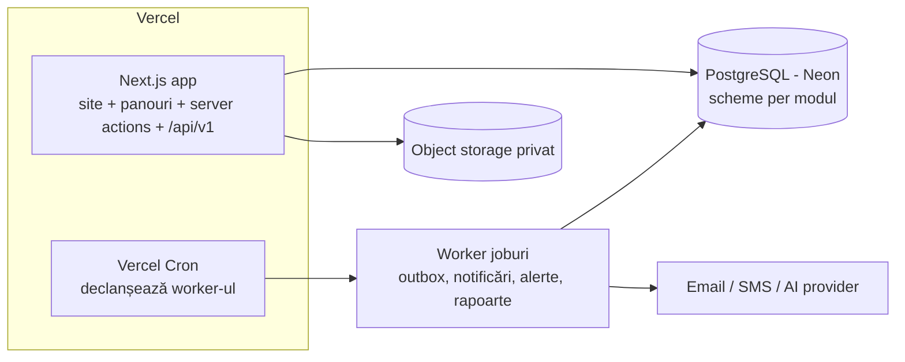

# CLAUDE — PUII MEI · 02 — Arhitectura sistemului și a bazei de date

**Autor:** Claude Code · **Data:** 23 noiembrie 2026 · **Versiune:** 0.2 (draft pentru comparație și aprobare)
**v0.2:** preluate din varianta ChatGPT (`CHATGPT-03-SYSTEM-ARCHITECTURE.md`, PR #50), marcate **[din ChatGPT]**: module
separate Contracte și Stocuri, rețete și costuri standard versionate, catalog de erori (RFC 9457), outbox cu dead-letter,
SLO / NFR, MFA, CSRF, scanarea fișierelor, rate limiting distribuit, zone de încredere, audit cu dovadă de integritate.
**Bază:** `CLAUDE-TECHNICAL-ARCHITECTURE-V1.md` (audit as-built), `00-SYSTEM-CONSTITUTION.md`,
`01-BUSINESS-ARCHITECTURE.md`, `adr/ADR-001-ONORARIU-PUII-MEI.md`, `TEAM-WORKFLOW.md`.
**Convenții:** **[CONFIRMAT]** decis / aprobat · **[PROPUS]** recomandarea mea · **[DESCHIS]** cere decizie sau validare ·
**[MIGRARE]** cum se trece de la codul actual. Nimic din acest document nu autorizează implementarea înainte de aprobare.

---

## Cuprins

1. Principii de arhitectură
2. Contextul sistemului (C4 nivel 1)
3. Containere (C4 nivel 2)
4. Modulele (granițe, responsabilități, dependențe)
5. Comunicarea dintre module: servicii, evenimente, outbox, joburi
6. Izolarea pe gospodărie (tenancy) și controlul accesului în stratul de date
7. Convențiile bazei de date
8. Schema completă (DDL) pe module
9. ERD
10. Invariante critice și cum le garantează baza de date
11. Istoricul modificărilor și auditul
12. Strategia de migrare din `documents` (JSONB)
13. Extinderea la alte verticale
14. Decizii deschise
15. Criterii de acceptanță și teste pentru acest document
16. Catalogul de erori [din ChatGPT]
17. Cerințe nefuncționale (SLO) [din ChatGPT]
18. Securitate transversală (completări) [din ChatGPT]

---

## 1. Principii de arhitectură

| ID | Principiu | Statut | Justificare |
|---|---|---|---|
| AR-01 | **Monolit modular** într-o singură aplicație Next.js + un worker pentru joburi; fără microservicii | [PROPUS] (în linie cu SC-022, MTS §5) | Echipă mică, volum de pilot (sute–mii de comenzi / an); un singur deploy, tranzacții locale. Granițele de modul permit extragerea ulterioară a unui modul, dacă volumul o cere. |
| AR-02 | **PostgreSQL relațional** = sursa de adevăr; o singură bază, câte o **schemă Postgres per modul** (`identity`, `household`, `production`, …) | [PROPUS] (SC-008) | FK între module rămân posibile; permisiunile pe schemă separă codul modulelor; o singură tranzacție când un flux trece prin mai multe module. |
| AR-03 | Fiecare modul își **deține tabelele**; alt modul le citește doar prin serviciul modulului sau prin **vederi publicate** (`<modul>_pub.*`), niciodată prin scriere directă | [PROPUS] (SC-023) | Regulile rămân într-un singur loc. |
| AR-04 | Mutațiile se fac prin **comenzi de domeniu** (funcții server) care: validează, verifică permisiunea pe obiect, scriu în tranzacție, scriu `audit_log` și evenimentele în `outbox` | [PROPUS] (SC-006, SC-009) | Atomicitate, idempotență, audit uniform. |
| AR-05 | **Fișierele** în object storage privat; în DB doar metadate, SHA-256, cheie de stocare | [PROPUS] (SC-014) | Rezolvă D-04 (Base64 în DB). |
| AR-06 | **Reguli de business configurabile, versionate** pe program (40 pui / țarc, 170 m², 60 zile, prețuri, limite), nu constante în cod | [PROPUS] (SC-019, SC-025) | Validări zootehnice / juridice viitoare fără redeploy; verticale noi. |
| AR-07 | **Interfețele** (site, client, gospodar, admin, roluri operaționale, AI) sunt **clienți** ai acelorași comenzi de domeniu; UI-ul nu conține reguli | [PROPUS] | O regulă, multe interfețe. |
| AR-08 | **API HTTP versionat** (`/api/v1`) doar pentru: aplicația mobilă viitoare, agenții AI, integrări (bancă, curier); UI-ul web folosește server actions care apelează aceleași comenzi | [PROPUS] | Nu dublăm logica; OpenAPI doar unde există consumatori externi. |
| AR-09 | Fără cache distribuit, fără coadă externă la start; joburile asincrone prin tabel `jobs` + worker (`SELECT … FOR UPDATE SKIP LOCKED`) | [PROPUS] | Complexitate minimă; se poate trece la o coadă gestionată fără a schimba interfața `enqueue()`. |

**Stack propus [PROPUS]:** Next.js 16 (existent) · TypeScript strict · PostgreSQL 16 (Neon) · **Drizzle ORM** + migrații SQL
versionate (vezi justificarea în §7.6) · Zod (existent) · object storage S3-compatibil (Vercel Blob sau Cloudflare R2,
[DESCHIS] alegerea furnizorului) · worker Node (Vercel Cron care declanșează procesarea `jobs`, sau proces separat) ·
Resend (email) · Twilio sau furnizor RO (SMS, [DESCHIS]) · Sentry (erori) · loguri structurate JSON.

---

## 2. Contextul sistemului (C4 nivel 1)

```mermaid
flowchart TB
  subgraph Actori
    C[Client final]
    G[Gospodar]
    A[Echipa PUII MEI<br/>admin, operațional, financiar, calitate]
    CU[Curier]
    I[Investitor]
    CT[Contabil extern]
    AI[Agenți AI]
  end
  P[[Platforma PUII MEI<br/>Central Command]]
  subgraph Externe
    B[(Bancă / extrase<br/>[DESCHIS])]
    E[Email - Resend]
    S[SMS - Twilio / RO]
    M[Hărți - OSM / Esri]
    OS[(Object storage)]
    AUT[Autorități: DSVSA, ANAF<br/>doar documente, fără integrare la start]
  end
  C -- precomandă, PIN, urmărire --> P
  G -- producție, jurnal, documente --> P
  A -- coordonare, aprobări --> P
  CU -- tură, predare --> P
  I -- investiții --> P
  CT -- documente, registru --> P
  AI -- propuneri prin API cu permisiuni --> P
  P --> E & S & M & OS
  B -. import extrase .-> P
```

**Zone de încredere [din ChatGPT]:** (1) public → HTTPS + rate limiting → aplicație; (2) echipa internă → autentificare
cu MFA → aplicație; (3) parteneri externi (contabil, bancă) → acces limitat, fără acces direct la baza de date;
(4) agenți AI → gateway de instrumente cu politici și aprobare umană; (5) aplicație → baza de date și stocarea privată
(rețea privată, credențiale separate). Niciun serviciu extern nu primește acces direct la baza de date.

---

## 3. Containere (C4 nivel 2)



| Container | Răspundere | Scalare |
|---|---|---|
| Next.js app | UI pentru toate rolurile, server actions, API v1, autentificare | serverless (Vercel) |
| Worker | procesează `outbox` (evenimente → notificări, recalculări), joburi programate (alerte de monitorizare, expirări PIN, rapoarte) | 1 instanță la start; idempotent |
| PostgreSQL | toate datele; scheme per modul | Neon; read replica doar la nevoie |
| Object storage | poze, documente, contracte semnate, etichete PDF | nelimitat; linkuri semnate cu expirare |

---

## 4. Modulele

| Modul (schemă) | Responsabilitate | Deține | Depinde de |
|---|---|---|---|
| **identity** | conturi, roluri, membership pe gospodărie, sesiuni, PIN-uri, invitații, rate limiting | users, roles, memberships, sessions, access_pins, login_attempts | — |
| **household** (Household OS) | entitatea economică a gospodăriei, profilul public, terenul, conturile bancare, mandatul, regimul (activă / suspendată), Compliance Gate | households, farm_profiles, land_parcels, bank_accounts, mandates, compliance_* , standing_events | identity, documents |
| **program** (Program Engine) | definirea programelor (ex. „Pui pășunat 60 zile”) și a versiunilor cu parametri; rețete și costuri standard versionate [din ChatGPT]; eligibilitatea gospodăriei; capacitatea | programs, program_versions, cost_standards, household_programs | household |
| **production** | loturi, țarcuri, efectivul și evenimentele lui, jurnalul de creștere, cântăriri, alerte de monitorizare | lots, pens, flock_events, growth_entries, weighings, monitoring_alerts | program, household |
| **commerce** (Marketplace) | clienți, produse, prețuri, precomenzi, alocarea pe țarcuri, anulări | customers, products, price_lists, orders, order_lines, allocations | production, program, household |
| **contracts** [din ChatGPT] | șabloane de contract versionate, contracte emise (client–gospodărie, administrare gospodărie–PUII MEI, investiții), acceptări și semnături | contract_templates, contract_template_versions, contracts, contract_parties, signatures | household, commerce, documents |
| **inventory** [din ChatGPT] | stocul gospodăriei: articole, recepții, consumuri, aprovizionare (pui de o zi, furaje, materiale) | inventory_items, supply_orders, stock_movements | household, production |
| **finance** | plăți (avans, sold), confirmări cu referință, rambursări, registrul gospodăriei, închiderea lotului, onorariul (ADR-001), facturi, investiții | payments, payment_confirmations, refunds, ledger_entries, lot_closings, fee_calculations, invoices, investments, repayments | commerce, production, household, documents |
| **logistics** | zone, procesare (sacrificare) ca etapă, colete, ture, curieri, temperaturi | zones, processing_runs, parcels, tours, tour_stops, tour_events | commerce, production |
| **quality** | verificări, neconformități, acțiuni corective, incidente, evaluări clienți, blocarea lotului | inspections, nonconformities, corrective_actions, incidents, ratings, lot_holds | production, logistics, household |
| **traceability** | *fără tabele proprii de scriere*: vederi care compun istoricul lotului / produsului din celelalte module; publicare către client | vederi `traceability.*` | toate (doar citire) |
| **documents** | fișiere (metadate + storage), documente cu categorie, verificare, legături la obiecte | files, documents, document_links | identity |
| **notifications** | șabloane, trimiteri email / SMS / in-app, preferințe, reîncercări | notification_templates, notifications | identity |
| **platform** | outbox, joburi, audit, setări, bibliotecă legislativă, formulare publice | outbox, jobs, audit_log, settings, legal_entries, applications, interest_signups, contact_messages | — |
| **ai** | registrul agenților, permisiuni, propuneri, aprobări umane, jurnalul acțiunilor AI | ai_agents, ai_proposals, ai_runs | toate prin API v1 |

**Regulă de dependență [PROPUS]:** graful e aciclic de jos în sus: `identity → household → program → production / inventory →
commerce → contracts → finance / logistics → quality → traceability (citire)`. Un modul „de jos” nu importă un modul „de sus”;
reacția la evenimentele de sus se face prin outbox (§5).

---

## 5. Comunicarea dintre module

1. **Apel sincron de serviciu** (în același proces, aceeași tranzacție) — pentru reguli care trebuie să fie atomice.
   Ex.: `commerce.placeOrder()` apelează `production.reserveCapacity()` în aceeași tranzacție.
2. **Evenimente de domeniu prin outbox** — pentru efecte secundare. Comanda de domeniu scrie evenimentul în
   `platform.outbox` în aceeași tranzacție; worker-ul îl livrează cel puțin o dată; consumatorii sunt idempotenți
   (cheie = `event_id`). **[din ChatGPT]** Reîncercare cu întârziere exponențială + jitter; după `max_attempts`
   evenimentul trece în **dead-letter** (`dead_lettered_at`), apare în Central Command și se reprocesează manual,
   cu audit. Evenimentele nu înlocuiesc tranzacțiile necesare.

Evenimente inițiale [PROPUS]:

| Eveniment | Emis de | Consumatori |
|---|---|---|
| `order.placed`, `order.allocated`, `order.waiting`, `order.cancelled` | commerce | notifications, finance (instrucțiuni plată), production (recalcul capacitate) |
| `payment.declared`, `payment.confirmed`, `payment.refunded` | finance | notifications, commerce (stare comandă) |
| `pen.started`, `flock.mortality_recorded`, `growth.entry_added` | production | quality (alerte), notifications (client: poza săptămânii) |
| `monitoring.alert_raised` | production (job) | notifications (admin), quality |
| `lot.ready`, `processing.completed` | production / logistics | logistics (ture), notifications |
| `parcel.delivered`, `parcel.confirmed` | logistics | finance (sold), quality (evaluare) |
| `lot.closed` | finance | finance (calcul onorariu ADR-001), analytics |
| `compliance.gate_changed`, `household.standing_changed` | household | production / commerce (blocare activitate) |
| `nonconformity.opened`, `lot.hold_placed` | quality | commerce / logistics (blocare livrare) |

3. **Joburi programate** (tabel `platform.jobs`): verificarea monitorizării (zilnic), expirarea PIN-urilor și a
   accesurilor, reamintiri de plată, rapoarte.

---

## 6. Izolarea pe gospodărie (tenancy)

[PROPUS] Model **shared database, shared schema**, cu coloana `household_id` pe fiecare rând care aparține unei gospodării.

1. **Aplicație:** fiecare comandă de domeniu primește un `ActorContext { userId, roles, householdIds[], customerId?,
   courierTourId?, agentId? }`. Repository-urile modulelor cer obligatoriu `ActorContext` și adaugă filtrul
   `household_id = ANY($householdIds)` pentru rolurile limitate (gospodar, membru al gospodăriei).
2. **Bază de date (apărare în adâncime):** Row Level Security pe tabelele cu `household_id`, cu politica
   `household_id = ANY (current_setting('app.household_ids')::uuid[]) OR current_setting('app.bypass_rls') = 'on'`.
   Aplicația setează `SET LOCAL app.household_ids` la începutul fiecărei tranzacții. Rolurile interne (admin) folosesc
   `app.bypass_rls`, jurnalizat. [PROPUS — de activat după migrare, nu de la prima zi, pentru a nu bloca migrarea.]
3. **Un utilizator poate avea mai multe gospodării** (membership), spre deosebire de codul actual (`farmSlug` unic).
4. **Clienții** nu sunt tenanți: accesul lor e pe obiect (comanda proprie), prin `customer_id` și PIN.

---

## 7. Convențiile bazei de date

| Convenție | Regulă |
|---|---|
| Chei primare | `uuid` generat în aplicație (UUID v7, sortabil în timp); coduri umane separate și unice (`code`, `number`) |
| Timp | `timestamptz` pentru momente, `date` pentru zile calendaristice; fus orar de afișare Europe/Bucharest |
| Bani | `bigint` în **bani** (1 leu = 100 bani), coloana `currency char(3) default 'RON'`; niciodată `float` |
| Cantități | `integer` pentru păsări; `numeric(10,3)` pentru kg; `numeric(6,2)` pentru °C |
| Enumerări | tipuri `text` + `CHECK (x IN (...))` (mai ușor de migrat decât `ENUM`) |
| Coloane de audit | `created_at`, `created_by`, `updated_at`, `updated_by`, `version integer` (blocare optimistă) |
| Ștergere | fără `DELETE` pe date financiare, de producție sau de livrare: anulare cu `voided_at`, `voided_by`, `void_reason`; date personale: anonimizare (GDPR) |
| Nume | tabele la plural, `snake_case`, FK `<entitate>_id` |
| JSONB | doar pentru: parametri de program (validați cu schema versiunii), payload de eveniment, răspunsuri de formular; niciodată pentru relații |

### 7.6 ORM [PROPUS]
**Drizzle ORM** (TypeScript, SQL apropiat, migrații SQL lizibile, fără runtime greu) în locul Prisma (schema existentă,
neconectată, se șterge — D-11). Alternativă acceptabilă: Prisma cu migrații SQL. [DESCHIS: aprobare ADR-002.]

---

## 8. Schema completă (DDL) pe module

> DDL PostgreSQL 16. Coloanele de audit standard (`created_at timestamptz not null default now(), created_by uuid,
> updated_at timestamptz, updated_by uuid, version integer not null default 1`) sunt notate `/* audit */` pentru
> concizie și sunt obligatorii pe fiecare tabel mutabil.
>
> **Verificat:** toate blocurile SQL din acest capitol (cu `/* audit */` expandat) au rulat fără erori pe PostgreSQL 16,
> într-o bază goală: 14 scheme, 77 de tabele (v0.2 + `compliance_holds`, 23 nov. 2026).

### 8.1 identity

```sql
create schema identity;

create table identity.users (
  id              uuid primary key,
  email           citext unique,                    -- null pentru conturi tehnice (agenți AI)
  phone           text,
  full_name       text not null,
  status          text not null check (status in ('invitat','activ','dezactivat','anonimizat')),
  password_hash   text,                              -- scrypt; null până la activare
  session_version integer not null default 1,        -- invalidare sesiuni
  last_login_at   timestamptz,
  /* audit */
);

create table identity.roles (            -- catalog: admin, operational, financiar, calitate, logistica,
  code        text primary key,           -- gospodar, membru_gospodarie, investitor, contabil, agent_ai
  description text not null
);

create table identity.user_roles (       -- roluri globale (echipa PUII MEI)
  user_id   uuid not null references identity.users(id),
  role_code text not null references identity.roles(code),
  granted_at timestamptz not null default now(),
  granted_by uuid,
  revoked_at timestamptz,
  primary key (user_id, role_code, granted_at)
);

create table identity.memberships (      -- acces limitat la o gospodărie
  id           uuid primary key,
  user_id      uuid not null references identity.users(id),
  household_id uuid not null,              -- FK adăugat după crearea household.households
  role_code    text not null check (role_code in ('gospodar','membru_gospodarie','contabil','investitor_observator')),
  valid_from   date not null default current_date,
  valid_to     date,
  /* audit */
  unique (user_id, household_id, role_code)
);

create table identity.invitations (
  id          uuid primary key,
  user_id     uuid not null references identity.users(id),
  token_hash  text not null unique,         -- se păstrează doar amprenta
  purpose     text not null check (purpose in ('activare','resetare_parola')),
  expires_at  timestamptz not null,
  used_at     timestamptz,
  created_at  timestamptz not null default now()
);

create table identity.mfa_factors (       -- MFA pentru admin, financiar, aprobări critice [din ChatGPT]
  id          uuid primary key,
  user_id     uuid not null references identity.users(id),
  kind        text not null check (kind in ('totp','webauthn')),
  secret_enc  bytea,                       -- TOTP criptat cu cheia aplicației
  credential  jsonb,                       -- WebAuthn
  created_at  timestamptz not null default now(),
  last_used_at timestamptz,
  revoked_at  timestamptz
);

create table identity.login_attempts (   -- rate limiting persistent, comun tuturor instanțelor (rezolvă D-05)
  id          bigserial primary key,
  key         text not null,               -- email normalizat sau IP
  succeeded   boolean not null,
  at          timestamptz not null default now()
);
create index on identity.login_attempts (key, at desc);

create table identity.access_pins (      -- PIN client (comandă) și PIN curier (tură)
  id          uuid primary key,
  subject     text not null check (subject in ('comanda','tura')),
  subject_id  uuid not null,
  pin_hash    text not null,               -- HMAC cu scop „pin”
  channel     text not null check (channel in ('sms','email','manual')),
  manual_pin  text,                        -- doar cât SMS-ul e neconfigurat; șters la folosire / expirare
  attempts    integer not null default 0 check (attempts <= 5),
  requested_at timestamptz not null default now(),
  expires_at  timestamptz not null,
  used_at     timestamptz
);
create index on identity.access_pins (subject, subject_id, requested_at desc);
```

### 8.2 household (Household OS)

```sql
create schema household;

create table household.households (      -- ENTITATEA ECONOMICĂ (juridică)
  id              uuid primary key,
  legal_form      text not null check (legal_form in ('PF','PFA','II','IF','SRL','altele')),  -- [DESCHIS BA-001]
  legal_name      text not null,
  tax_id          text,                     -- CUI / CNP (criptat la nivel de coloană, vezi spec. securitate)
  trade_register  text,
  address         text not null,
  county          text not null,
  locality        text not null,
  lot_code_prefix char(2) not null,         -- inițialele localității (MS, FM…) [CONFIRMAT]
  standing        text not null default 'in_evaluare'
                  check (standing in ('in_evaluare','activa','avertizata','suspendata','exclusa','inchisa')),
  compliance_status text not null default 'neverificat'
                  check (compliance_status in ('neverificat','incomplet','valid','expirat','suspendat')),
  /* audit */
);

alter table identity.memberships add foreign key (household_id) references household.households(id);

create table household.farm_profiles (   -- PROFILUL PUBLIC (site)
  household_id      uuid primary key references household.households(id),
  slug              text not null unique,
  display_name      text not null,
  owner_display     text not null,
  short_description text not null check (length(short_description) <= 220),
  description       text not null,
  practices         text[] not null default '{}',
  latitude          numeric(9,6),
  longitude         numeric(9,6),
  vet_registration_public text,
  is_public         boolean not null default false,
  /* audit */
);

create table household.land_parcels (
  id               uuid primary key,
  household_id     uuid not null references household.households(id),
  title_kind       text not null check (title_kind in ('proprietate','comodat','arenda','inchiriere')),
  declared_m2      integer not null check (declared_m2 > 0),
  verified_m2      integer check (verified_m2 >= 0),
  verified_at      timestamptz,
  verified_by      uuid references identity.users(id),
  proof_document_id uuid,                    -- documents.documents
  boundary_geojson jsonb,                    -- conturul măsurat în teren [PROPUS]
  valid_to         date,                     -- pentru comodat / arendă
  /* audit */
);
create index on household.land_parcels (household_id);

create table household.bank_accounts (
  id            uuid primary key,
  household_id  uuid not null references household.households(id),
  holder        text not null,
  iban          text not null check (iban ~ '^RO[0-9]{2}[A-Z]{4}[0-9A-Z]{16}$'),
  bank_name     text,
  purpose       text not null check (purpose in ('incasari_clienti','plati')),
  is_default    boolean not null default false,
  /* audit */
);
create unique index on household.bank_accounts (household_id, purpose) where is_default;

create table household.mandates (        -- mandatul PUII MEI [DESCHIS BA-002]
  id            uuid primary key,
  household_id  uuid not null references household.households(id),
  scope         text[] not null,           -- ex. {'documente','comenzi','plati_furnizori'}
  limits        jsonb not null default '{}', -- ex. plafon plăți
  signed_document_id uuid,
  valid_from    date not null,
  valid_to      date,
  revoked_at    timestamptz,
  /* audit */
);

create table household.compliance_requirements (  -- catalog per program / tip de activitate
  id            uuid primary key,
  code          text not null unique,      -- ex. 'DSV_INREGISTRARE', 'ACT_TEREN', 'CONTRACT_ADMINISTRARE'
  title         text not null,
  applies_to    text not null,             -- 'gospodarie' sau codul programului
  evidence_kind text not null,             -- 'document','inspectie','declaratie'
  validity_days integer,                   -- null = nu expiră
  mandatory     boolean not null default true,
  authority     text                       -- DSVSA, contabil, jurist…
);

create table household.compliance_checks (        -- Compliance Gate (SC-043)
  id             uuid primary key,
  household_id   uuid not null references household.households(id),
  requirement_id uuid not null references household.compliance_requirements(id),
  status         text not null check (status in ('lipsa','in_verificare','valid','respins','expirat')),
  evidence_document_id uuid,
  checked_at     timestamptz,
  checked_by     uuid references identity.users(id),
  expires_at     timestamptz,
  note           text,
  /* audit */
  unique (household_id, requirement_id)
);

create table household.compliance_holds (         -- suspendare de conformitate cu severitate (F-02, CG-06)
  id             uuid primary key,
  household_id   uuid not null references household.households(id),
  check_id       uuid references household.compliance_checks(id),  -- null = constatare fără cerință din catalog
  cause          text not null check (cause in ('expirare_document','respingere_dovada','constatare_control',
                                                 'decizie_autoritate','incident_calitate','alta')),
  severity       text not null check (severity in ('informare','restrictie','oprire')),
  affected       text[] not null check (cardinality(affected) > 0 and affected <@ array['loturi_noi','alocari_noi',
                   'crestere','procesare','comercializare','livrare']::text[]),
  lot_ids        uuid[],                    -- null = toată gospodăria; altfel doar loturile enumerate
  reason         text not null,
  issuer         text not null,             -- 'calitate', 'DSVSA', 'jurist'… (cine a constatat)
  starts_at      timestamptz not null default now(),
  review_at      timestamptz,               -- termen de reanalizare (obligatoriu la 'oprire', vezi check)
  status         text not null default 'activ' check (status in ('activ','ridicat')),
  lifted_at      timestamptz,
  lifted_by      uuid references identity.users(id),
  lift_evidence_document_id uuid,
  placed_by      uuid not null references identity.users(id),
  check ((status = 'ridicat') = (lifted_at is not null and lifted_by is not null)),
  check (severity <> 'oprire' or review_at is not null),
  /* audit */
);
create index on household.compliance_holds (household_id) where status = 'activ';

create table household.standing_events (          -- istoric regim (avertizare, suspendare…)
  id            uuid primary key,
  household_id  uuid not null references household.households(id),
  from_standing text not null,
  to_standing   text not null,
  reason        text not null,
  decided_by    uuid not null references identity.users(id),
  decided_at    timestamptz not null default now()
);
```

### 8.3 program (Program Engine)

```sql
create schema program;

create table program.programs (
  id          uuid primary key,
  code        text not null unique,          -- ex. 'PUI_PASUNE_60'
  vertical    text not null,                 -- 'pui','curcani','rate','fazani','legume','borcane','pastravi'…
  name        text not null,
  status      text not null check (status in ('ciorna','activ','retras')),
  /* audit */
);

create table program.program_versions (     -- parametrii versionați (AR-06)
  id           uuid primary key,
  program_id   uuid not null references program.programs(id),
  version      integer not null,
  params       jsonb not null,               -- validat de schema verticalei (vezi mai jos)
  params_schema_version integer not null,
  effective_from date not null,
  approved_by  uuid references identity.users(id),
  approved_at  timestamptz,
  unique (program_id, version)
);
-- Exemplu params pentru PUI_PASUNE_60. Valorile operaționale sunt [CONFIRMAT ca ipoteze] (SC-019); cele
-- zootehnice sunt parametri SEPARAȚI, fiecare cu statutul validării (vezi CLAUDE-VERIFICATION-V1 §3):
-- { "birds_per_pen": 40, "pasture_m2_per_pen": 170, "growth_days": 60, "indoor_days": 21,
--   "pen_start_window_days": 7, "move_alert_days": 2, "photo_interval_days": 7, "one_lot_at_a_time": true,
--   "limits": { "birds_per_year": 10000, "birds_per_lot": 300 },
--   "zootech": {
--     "target_carcass_kg":   { "value": 4.8,  "status": "ipoteza_nevalidata" },
--     "carcass_yield":       { "value": 0.70, "status": "ipoteza_nevalidata" },   -- randament la sacrificare (carcasă / viu)
--     "fcr_kg_feed_per_kg_live": { "value": null, "status": "de_stabilit_zootehnic" }  -- conversia furajului (FCR)
--   } }
-- Furajul / pui se CALCULEAZĂ = (target_carcass_kg / carcass_yield) × fcr; nu se mai stochează „9,8 kg” și nici
-- „asimilare 70%” (care confunda randamentul la sacrificare cu conversia furajului).

create table program.household_programs (   -- gospodăria înscrisă într-un program
  id            uuid primary key,
  household_id  uuid not null references household.households(id),
  program_id    uuid not null references program.programs(id),
  status        text not null check (status in ('propus','eligibil','activ','suspendat','incheiat')),
  capacity_override jsonb,                   -- limite proprii aprobate de admin
  /* audit */
  unique (household_id, program_id)
);

create table program.cost_standards (       -- rețete și costuri standard versionate [din ChatGPT, ADR-TECH-010]
  id                 uuid primary key,
  program_version_id uuid not null references program.program_versions(id),
  category           text not null,          -- aceleași categorii ca registrul (pui, furaj, sanatate, energie…)
  basis              text not null check (basis in ('per_pui','per_kg','per_lot','per_zi')),
  quantity           numeric(12,3),          -- ex. 9,8 kg furaj / pui [ipoteză de validat zootehnic]
  unit               text,
  amount_bani        bigint not null check (amount_bani >= 0),
  tolerance_pct      numeric(5,2) not null default 10.00,   -- peste ea, abaterea cere justificare
  approved_by        uuid references identity.users(id),
  approved_at        timestamptz,
  unique (program_version_id, category, basis)
);
-- Folosire: bugetul lotului, avansul (pui + furaj), și — dacă ADR-001 se definește pe „cheltuieli standard” —
-- calculul onorariului. Abaterile real vs. standard se înregistrează în finance.cost_variances.
```

### 8.4 production

```sql
create schema production;

create table production.lots (
  id                 uuid primary key,
  code               text not null unique,           -- MS-2026-01 [CONFIRMAT]
  household_id       uuid not null references household.households(id),
  program_version_id uuid not null references program.program_versions(id),
  planned_start      date not null,
  breed              text not null,
  feed_description   text not null,
  processing_description text not null,
  pens_planned       integer not null check (pens_planned > 0),
  status             text not null check (status in
                     ('propus','aprobat','respins','deschis_precomenzi','in_crestere','la_procesare','livrat','inchis','anulat')),
  approval_decided_by uuid references identity.users(id),
  approval_decided_at timestamptz,
  rejection_reason   text,
  public_notes       text,
  /* audit */
);
create index on production.lots (household_id, planned_start);

create table production.pens (                       -- țarcul = sublot (SC-010)
  id           uuid primary key,
  lot_id       uuid not null references production.lots(id),
  number       integer not null check (number > 0),
  capacity     integer not null check (capacity > 0),  -- din program (40)
  started_at   date,                                   -- intrarea puilor de o zi
  started_by   uuid references identity.users(id),
  status       text not null check (status in ('gol','se_umple','plin','pornit','pe_pasune','gata','inchis')),
  /* audit */
  unique (lot_id, number)
);

create table production.flock_events (               -- efectivul: append-only (SC-011)
  id          uuid primary key,
  pen_id      uuid not null references production.pens(id),
  kind        text not null check (kind in ('intrare','mortalitate','sacrificare','transfer_iesire','transfer_intrare','corectie')),
  quantity    integer not null check (quantity > 0),
  occurred_on date not null,
  cause       text,
  evidence_photo_id uuid,
  corrects_event_id uuid references production.flock_events(id),  -- rectificare, nu ștergere
  recorded_by uuid not null references identity.users(id),
  recorded_at timestamptz not null default now()
);
create index on production.flock_events (pen_id, occurred_on);
-- efectivul curent = vedere: sum(intrare + transfer_intrare) − sum(mortalitate + sacrificare + transfer_iesire) ± corecții

create table production.growth_entries (             -- jurnalul de creștere: append-only
  id           uuid primary key,
  lot_id       uuid not null references production.lots(id),
  pen_id       uuid references production.pens(id),
  kind         text not null check (kind in ('mutare','hranire','apa','tratament','curatenie','poza','veterinar','altele')),
  occurred_on  date not null,
  note         text,
  vet_name     text,
  photo_file_id uuid,
  latitude     numeric(9,6),
  longitude    numeric(9,6),
  gps_accuracy_m numeric(8,1),
  recorded_by  uuid not null references identity.users(id),
  recorded_at  timestamptz not null default now()
);
create index on production.growth_entries (lot_id, occurred_on desc);
create index on production.growth_entries (pen_id, kind, occurred_on desc);

create table production.weighings (                  -- greutate (eșantion)
  id          uuid primary key,
  pen_id      uuid not null references production.pens(id),
  occurred_on date not null,
  sample_size integer not null check (sample_size > 0),
  avg_live_kg numeric(10,3) not null check (avg_live_kg > 0),
  recorded_by uuid not null references identity.users(id),
  recorded_at timestamptz not null default now()
);

create table production.monitoring_alerts (
  id          uuid primary key,
  lot_id      uuid not null references production.lots(id),
  pen_id      uuid references production.pens(id),
  rule        text not null,            -- 'mutare_lipsa','poza_lipsa','mortalitate_ridicata'…
  raised_at   timestamptz not null default now(),
  resolved_at timestamptz,
  resolved_by uuid references identity.users(id),
  unique (lot_id, pen_id, rule, raised_at)
);
create index on production.monitoring_alerts (resolved_at) where resolved_at is null;
```

### 8.5 commerce

```sql
create schema commerce;

create table commerce.customers (
  id         uuid primary key,
  full_name  text not null,
  phone      text not null,
  email      citext,
  marketing_consent boolean not null default false,
  anonymized_at timestamptz,          -- GDPR
  /* audit */
);
create index on commerce.customers (phone);

create table commerce.products (       -- ce se vinde (extindere la alte verticale, §13)
  id          uuid primary key,
  program_id  uuid not null references program.programs(id),
  code        text not null unique,    -- ex. 'PUI_CURATAT'
  name        text not null,           -- „Pui curățat, gata de gătit” [CONFIRMAT termen]
  unit        text not null check (unit in ('kg','buc','borcan')),
  est_unit_weight_kg numeric(10,3),
  active      boolean not null default true
);

create table commerce.price_lists (     -- prețul pieței + adaos, cu istoric
  id                uuid primary key,
  product_id        uuid not null references commerce.products(id),
  market_price_bani bigint not null check (market_price_bani > 0),
  markup_pct        numeric(5,2) not null check (markup_pct between 0 and 100),
  client_price_bani bigint generated always as (round(market_price_bani * (1 + markup_pct/100))) stored,
  effective_from    timestamptz not null,
  source_note       text,
  /* audit */
);
create index on commerce.price_lists (product_id, effective_from desc);

create table commerce.orders (           -- precomanda
  id              uuid primary key,
  number          text not null unique,     -- PM2611-XXXXX
  customer_id     uuid not null references commerce.customers(id),
  parent_order_id uuid references commerce.orders(id),   -- părți ale unei comenzi împărțite
  zone_id         uuid not null,             -- logistics.zones
  delivery_address text,
  delivery_lat    numeric(9,6),
  delivery_lng    numeric(9,6),
  status          text not null check (status in
                  ('noua','in_asteptare','alegere_client','alocata','avans_platit','in_crestere','gata','in_livrare','livrata','anulata')),
  price_list_id   uuid not null references commerce.price_lists(id),   -- prețul înghețat la plasare
  est_total_bani  bigint not null,
  delivery_fee_bani bigint not null default 0,
  idempotency_key text unique,              -- dublu-click / retry
  terms_version   text not null,            -- versiunea termenilor acceptați
  terms_accepted_at timestamptz not null,
  cancelled_at    timestamptz,
  cancel_reason   text,
  notes           text,
  /* audit */
);
create index on commerce.orders (customer_id);
create index on commerce.orders (status, created_at);

create table commerce.order_lines (
  id          uuid primary key,
  order_id    uuid not null references commerce.orders(id),
  product_id  uuid not null references commerce.products(id),
  quantity    integer not null check (quantity > 0),       -- nr. pui
  unit_price_bani bigint not null,
  est_weight_kg numeric(10,3) not null,
  final_weight_kg numeric(10,3),                            -- cântărit la livrare
  /* audit */
);

create table commerce.allocations (      -- rezervarea capacității: comanda → țarc
  id          uuid primary key,
  order_line_id uuid not null references commerce.order_lines(id),
  pen_id      uuid not null references production.pens(id),
  household_id uuid not null references household.households(id),   -- denormalizat pentru RLS
  quantity    integer not null check (quantity > 0),
  status      text not null check (status in ('rezervat','confirmat','eliberat')),
  released_reason text,
  /* audit */
);
create index on commerce.allocations (pen_id) where status <> 'eliberat';

```

### 8.5b contracts [din ChatGPT]

```sql
create schema contracts;

create table contracts.contract_templates (
  id          uuid primary key,
  code        text not null unique,      -- 'CLIENT_GOSPODARIE', 'ADMINISTRARE_GOSPODARIE', 'INVESTITIE'
  title       text not null,
  kind        text not null check (kind in ('client','administrare','mandat','investitie','furnizor','alt')),
  /* audit */
);

create table contracts.contract_template_versions (
  id           uuid primary key,
  template_id  uuid not null references contracts.contract_templates(id),
  version_label text not null,           -- ex. '1.0' (coloana `version` e rezervată blocării optimiste)
  body_markdown text not null,             -- text cu câmpuri {{…}}
  legal_review text not null check (legal_review in ('nevalidat','in_revizuire','validat')),  -- [DESCHIS CX-01]
  effective_from date,
  /* audit */
  unique (template_id, version_label)
);

create table contracts.contracts (
  id                  uuid primary key,
  template_version_id uuid not null references contracts.contract_template_versions(id),
  household_id        uuid references household.households(id),
  order_id            uuid references commerce.orders(id),
  investment_id       uuid,                  -- finance.investments (FK adăugat după crearea tabelului)
  status              text not null check (status in ('ciorna','emis','acceptat','semnat','reziliat','expirat')),
  rendered_file_id    uuid,                  -- PDF generat
  valid_from          date,
  valid_to            date,
  /* audit */
);
create index on contracts.contracts (order_id);
create index on contracts.contracts (household_id);

create table contracts.contract_parties (
  contract_id uuid not null references contracts.contracts(id),
  role        text not null check (role in ('client','gospodarie','puii_mei','investitor','furnizor')),
  party_ref   uuid not null,                 -- customer_id / household_id / user_id
  display_name text not null,
  primary key (contract_id, role, party_ref)
);

create table contracts.signatures (
  id          uuid primary key,
  contract_id uuid not null references contracts.contracts(id),
  party_role  text not null,
  method      text not null check (method in ('acceptare_online','semnatura_olografa_scanata','semnatura_electronica')),
  signed_at   timestamptz not null,
  ip          inet,
  evidence_file_id uuid
);
```

### 8.6 finance

```sql
create schema finance;

create table finance.payments (           -- banii clientului → gospodărie (F1, F5)
  id            uuid primary key,
  order_id      uuid not null references commerce.orders(id),
  household_id  uuid not null references household.households(id),
  kind          text not null check (kind in ('avans','sold','rambursare')),
  amount_bani   bigint not null check (amount_bani > 0),
  status        text not null check (status in ('asteptata','declarata_client','confirmata','respinsa','anulata')),
  payment_reference text not null unique,   -- referința unică din instrucțiunile de plată
  declared_at   timestamptz,
  /* audit */
);
create unique index on finance.payments (order_id, kind) where kind = 'avans' and status <> 'anulata';

create table finance.payment_confirmations (   -- dovada (SC-017, F1 pas 4)
  id            uuid primary key,
  payment_id    uuid not null references finance.payments(id),
  bank_reference text not null,             -- nr. extras / OP
  received_on   date not null,
  amount_bani   bigint not null,
  evidence_document_id uuid,
  confirmed_by  uuid not null references identity.users(id),
  confirmed_at  timestamptz not null default now(),
  unique (bank_reference, payment_id)
);

create table finance.ledger_entries (       -- registrul gospodăriei (cheltuieli și venituri)
  id            uuid primary key,
  household_id  uuid not null references household.households(id),
  lot_id        uuid references production.lots(id),
  direction     text not null check (direction in ('cheltuiala','venit')),
  category      text not null,              -- catalog: pui, furaj, sanatate, energie, asternut, ambalaje, transport,
                                            -- manopera, taxe, onorariu_puii_mei, contabilitate, vanzare, avans, altele
  counterparty  text not null,
  description   text not null,
  amount_bani   bigint not null check (amount_bani > 0),
  vat_bani      bigint,
  document_number text,
  document_id   uuid,
  occurred_on   date not null,
  state         text not null check (state in ('ciorna','confirmat','anulat')),
  confirmed_at  timestamptz,
  confirmed_by  uuid references identity.users(id),
  void_reason   text,
  /* audit */
  check (state <> 'confirmat' or (document_number is not null and document_id is not null))
);
create index on finance.ledger_entries (household_id, occurred_on);
create index on finance.ledger_entries (lot_id);

create table finance.lot_closings (           -- închiderea lotului și calculul onorariului (ADR-001)
  id               uuid primary key,
  lot_id           uuid not null unique references production.lots(id),
  revenue_bani     bigint not null,
  expenses_bani    bigint not null,
  difference_bani  bigint generated always as (revenue_bani - expenses_bani) stored,
  fee_pct          numeric(5,2) not null default 10.00,          -- [CONFIRMAT ADR-001]
  fee_bani         bigint not null,              -- = round(fee_pct% × max(0, difference)); calculat de aplicație
  rules_version    text not null,                -- definiția venituri / cheltuieli [DESCHIS ADR-001]
  status           text not null check (status in ('calcul','verificat_gospodar','aprobat','facturat','contestat')),
  /* audit */
);

create table finance.cost_variances (       -- abateri real vs. standard [din ChatGPT]
  id               uuid primary key,
  lot_id           uuid not null references production.lots(id),
  cost_standard_id uuid not null references program.cost_standards(id),
  standard_bani    bigint not null,
  actual_bani      bigint not null,
  justification    text,
  status           text not null check (status in ('in_limita','de_justificat','acceptata','respinsa')),
  decided_by       uuid references identity.users(id),
  /* audit */
);

create table finance.invoices (               -- facturi PUII MEI → gospodărie (onorariu)
  id           uuid primary key,
  household_id uuid not null references household.households(id),
  lot_closing_id uuid references finance.lot_closings(id),
  series       text not null,
  number       integer not null,
  issued_on    date not null,
  net_bani     bigint not null,
  vat_bani     bigint not null,
  file_id      uuid,
  status       text not null check (status in ('emisa','platita','stornata')),
  unique (series, number)
);

create table finance.refunds (                -- rambursări către client [DESCHIS BA-007]
  id           uuid primary key,
  payment_id   uuid not null references finance.payments(id),
  amount_bani  bigint not null check (amount_bani > 0),
  reason       text not null,
  policy_rule  text not null,                 -- regula aplicată (ex. preluare de alt client)
  status       text not null check (status in ('propusa','aprobata','platita','respinsa')),
  /* audit */
);

create table finance.investments (            -- [DESCHIS DEC-007] statut juridic
  id            uuid primary key,
  investor_user_id uuid not null references identity.users(id),
  household_id  uuid references household.households(id),
  title         text not null,
  amount_bani   bigint not null check (amount_bani > 0),
  signed_on     date,
  status        text not null check (status in ('propusa','semnata','activa','finalizata','anulata')),
  terms_summary text,
  repayment_per_bird_bani bigint,             -- [DESCHIS] „de stabilit”
  /* audit */
);

alter table contracts.contracts add foreign key (investment_id) references finance.investments(id);

create table finance.investment_events (
  id            uuid primary key,
  investment_id uuid not null references finance.investments(id),
  occurred_on   date not null,
  title         text not null,
  detail        text,
  recorded_by   uuid not null references identity.users(id),
  recorded_at   timestamptz not null default now()
);

create table finance.repayments (
  id            uuid primary key,
  investment_id uuid not null references finance.investments(id),
  lot_id        uuid references production.lots(id),
  birds         integer,
  amount_bani   bigint not null check (amount_bani > 0),
  paid_on       date not null,
  bank_reference text,
  /* audit */
);
```

### 8.7 logistics

```sql
create schema logistics;

create table logistics.zones (
  id            uuid primary key,
  code          text not null unique,
  name          text not null,
  localities    text not null,
  delivery_day  text not null,
  fee_bani      bigint not null check (fee_bani >= 0),
  center_lat    numeric(9,6),
  center_lng    numeric(9,6),
  kind          text not null check (kind in ('livrare','ridicare','lista_asteptare')),
  active        boolean not null default true,
  /* audit */
);

create table logistics.processing_runs (   -- sacrificare / procesare ca etapă trasabilă [DESCHIS BA-003]
  id            uuid primary key,
  lot_id        uuid not null references production.lots(id),
  pen_id        uuid references production.pens(id),
  processed_on  date not null,
  location      text not null,               -- în gospodărie sau unitate autorizată
  operator      text not null,
  birds         integer not null check (birds > 0),
  total_carcass_kg numeric(10,3),
  temperature_c numeric(6,2),
  /* audit */
);

create table logistics.parcels (
  id            uuid primary key,
  order_id      uuid not null unique references commerce.orders(id),
  household_id  uuid not null references household.households(id),
  label_version integer not null default 1,
  client_token_hash  text not null unique,
  courier_token_hash text not null unique,
  expires_on    date not null,
  tour_id       uuid,
  loaded_at     timestamptz,
  loaded_temp_c numeric(6,2),
  delivered_at  timestamptz,
  delivered_temp_c numeric(6,2),
  delivered_lat numeric(9,6),
  delivered_lng numeric(9,6),
  signature_file_id uuid,
  confirmed_at  timestamptz,
  /* audit */
);

create table logistics.tours (
  id            uuid primary key,
  code          text not null unique,
  household_id  uuid not null references household.households(id),
  tour_date     date not null,
  status        text not null check (status in ('planificata','in_curs','incheiata','anulata')),
  duration_hours integer not null,
  courier_name  text,
  courier_phone text,
  vehicle_plate text,
  pickup_pin_hash text,
  failed_pins   integer not null default 0,
  locked        boolean not null default false,
  started_at    timestamptz,
  finished_at   timestamptz,
  /* audit */
);
alter table logistics.parcels add foreign key (tour_id) references logistics.tours(id);

create table logistics.tour_stops (
  tour_id    uuid not null references logistics.tours(id),
  parcel_id  uuid not null references logistics.parcels(id),
  position   integer not null,
  primary key (tour_id, parcel_id),
  unique (tour_id, position)
);

create table logistics.tour_events (       -- jurnal append-only al turei (existent în cod)
  id          uuid primary key,
  tour_id     uuid not null references logistics.tours(id),
  kind        text not null,
  payload     jsonb not null default '{}',
  latitude    numeric(9,6),
  longitude   numeric(9,6),
  actor       text not null,
  at          timestamptz not null default now()
);
create index on logistics.tour_events (tour_id, at);
```

### 8.7b inventory [din ChatGPT]

```sql
create schema inventory;

create table inventory.inventory_items (
  id        uuid primary key,
  code      text not null unique,          -- 'FURAJ_START', 'FURAJ_CRESTERE', 'RUMEGUS', 'PUNGI_VID'…
  name      text not null,
  unit      text not null check (unit in ('kg','buc','sac','l')),
  category  text not null check (category in ('pui_o_zi','furaj','asternut','ambalaje','medicamente','alte'))
);

create table inventory.supply_orders (     -- aprovizionare: pui de o zi, furaje, materiale
  id            uuid primary key,
  household_id  uuid not null references household.households(id),
  lot_id        uuid references production.lots(id),
  item_id       uuid not null references inventory.inventory_items(id),
  quantity      numeric(12,3) not null,
  unit          text not null,
  supplier      text not null,
  status        text not null check (status in ('planificata','comandata','livrata','anulata')),
  delivered_on  date,
  ledger_entry_id uuid references finance.ledger_entries(id),
  /* audit */
);

create table inventory.stock_movements (   -- stocul gospodăriei (furaje, materiale)
  id            uuid primary key,
  household_id  uuid not null references household.households(id),
  item_id       uuid not null references inventory.inventory_items(id),
  quantity      numeric(12,3) not null,       -- + intrare, − consum
  reason        text not null check (reason in ('livrare','consum','pierdere','corectie')),
  lot_id        uuid references production.lots(id),
  occurred_on   date not null,
  recorded_by   uuid not null references identity.users(id),
  recorded_at   timestamptz not null default now()
);
create index on inventory.stock_movements (household_id, item_id, occurred_on);

```

### 8.8 quality

```sql
create schema quality;

create table quality.inspections (
  id           uuid primary key,
  household_id uuid not null references household.households(id),
  lot_id       uuid references production.lots(id),
  kind         text not null check (kind in ('veterinar','intern','autoritate','client')),
  occurred_on  date not null,
  inspector    text not null,
  result       text not null check (result in ('conform','neconform','observatii')),
  report_document_id uuid,
  /* audit */
);

create table quality.nonconformities (
  id           uuid primary key,
  household_id uuid not null references household.households(id),
  lot_id       uuid references production.lots(id),
  source       text not null check (source in ('inspectie','monitorizare','livrare','reclamatie','audit')),
  severity     text not null check (severity in ('minora','majora','critica')),
  description  text not null,
  status       text not null check (status in ('deschisa','in_remediere','inchisa','anulata')),
  opened_at    timestamptz not null default now(),
  closed_at    timestamptz,
  /* audit */
);

create table quality.corrective_actions (
  id             uuid primary key,
  nonconformity_id uuid not null references quality.nonconformities(id),
  action         text not null,
  owner_user_id  uuid references identity.users(id),
  due_on         date,
  done_at        timestamptz,
  evidence_document_id uuid,
  /* audit */
);

create table quality.lot_holds (            -- blocarea alocării / livrării (SC-020)
  id           uuid primary key,
  lot_id       uuid not null references production.lots(id),
  reason       text not null,
  placed_by    uuid not null references identity.users(id),
  placed_at    timestamptz not null default now(),
  released_by  uuid references identity.users(id),
  released_at  timestamptz
);
create unique index on quality.lot_holds (lot_id) where released_at is null;

create table quality.ratings (
  id          uuid primary key,
  parcel_id   uuid not null unique references logistics.parcels(id),
  farm_score  smallint check (farm_score between 1 and 5),
  courier_score smallint check (courier_score between 1 and 5),
  platform_score smallint check (platform_score between 1 and 5),
  comment     text,
  submitted_at timestamptz not null default now()
);
```

### 8.9 documents, notifications, platform, ai

```sql
create schema documents;
create table documents.files (
  id           uuid primary key,
  storage_key  text not null unique,      -- cheia în object storage
  original_name text not null,
  mime         text not null,
  size_bytes   bigint not null check (size_bytes > 0),
  sha256       char(64) not null,
  detected_mime text not null,             -- din „magic bytes”, nu din extensie [din ChatGPT]
  scan_status  text not null default 'in_asteptare'
               check (scan_status in ('in_asteptare','curat','infectat','eroare')),  -- fișierul nu se servește până e „curat”
  retention_until date,
  uploaded_by  uuid,
  uploaded_at  timestamptz not null default now()
);
create table documents.documents (
  id           uuid primary key,
  household_id uuid references household.households(id),
  category     text not null check (category in ('factura','aviz','contabil','dsv','contract','proprietate','raport','altele')),
  title        text not null,
  number       text,
  issued_on    date not null,
  file_id      uuid not null references documents.files(id),
  verified_at  timestamptz,
  verified_by  uuid references identity.users(id),
  /* audit */
);
create table documents.document_links (   -- document ↔ obiect (lot, investiție, comandă…)
  document_id uuid not null references documents.documents(id),
  object_type text not null,
  object_id   uuid not null,
  primary key (document_id, object_type, object_id)
);

create schema notifications;
create table notifications.notifications (
  id          uuid primary key,
  channel     text not null check (channel in ('email','sms','in_app','whatsapp_manual')),
  recipient   text not null,
  template    text not null,
  payload     jsonb not null,
  status      text not null check (status in ('in_coada','trimisa','esuata','anulata')),
  attempts    integer not null default 0,
  last_error  text,
  event_id    uuid,                         -- idempotență față de outbox
  created_at  timestamptz not null default now(),
  sent_at     timestamptz,
  unique (event_id, channel, recipient)
);

create schema platform;
create table platform.outbox (
  id          uuid primary key,
  event_type  text not null,
  aggregate   text not null,
  aggregate_id uuid not null,
  payload     jsonb not null,
  occurred_at timestamptz not null default now(),
  attempts    integer not null default 0,
  next_attempt_at timestamptz not null default now(),
  last_error  text,
  processed_at timestamptz,
  dead_lettered_at timestamptz             -- [din ChatGPT] reprocesare manuală, cu audit
);
create index on platform.outbox (next_attempt_at) where processed_at is null and dead_lettered_at is null;

create table platform.jobs (
  id          uuid primary key,
  kind        text not null,
  run_at      timestamptz not null,
  payload     jsonb not null default '{}',
  status      text not null check (status in ('in_asteptare','in_lucru','reusit','esuat')),
  attempts    integer not null default 0,
  locked_at   timestamptz,
  last_error  text
);
create index on platform.jobs (status, run_at);

create table platform.audit_log (             -- append-only (rezolvă D-08)
  id          bigserial primary key,
  at          timestamptz not null default now(),
  actor_type  text not null check (actor_type in ('user','client_pin','courier','agent_ai','system')),
  actor_id    text not null,
  action      text not null,                  -- ex. 'lot.approve'
  object_type text not null,
  object_id   text not null,
  household_id uuid,
  before      jsonb,
  after       jsonb,
  reason      text,
  request_id  text,
  prev_hash   char(64),                    -- [din ChatGPT] lanț de amprente: dovadă de integritate,
  row_hash    char(64) not null            -- sha256(prev_hash || conținut); verificat periodic de un job
);
create index on platform.audit_log (object_type, object_id, at);
create index on platform.audit_log (household_id, at);
-- Drepturi: aplicația are doar INSERT și SELECT pe audit_log (REVOKE UPDATE, DELETE).

create table platform.settings (key text primary key, value jsonb not null, /* audit */);
create table platform.legal_entries (id uuid primary key, kind text not null, title text not null, summary text not null,
  source_url text, status text not null, published_on date, /* audit */);
create table platform.applications (id uuid primary key, kind text not null check (kind in ('gospodar','investitor')),
  payload jsonb not null, status text not null, internal_note text, /* audit */);
create table platform.interest_signups (id uuid primary key, full_name text not null, email citext not null,
  phone text, county text not null, products text[] not null, created_at timestamptz not null default now());
create table platform.contact_messages (id uuid primary key, full_name text not null, email citext not null,
  message text not null, created_at timestamptz not null default now(), handled_at timestamptz);

create schema ai;
create table ai.agents (
  id          uuid primary key,
  code        text not null unique,            -- 'agent_productie', 'agent_comercial'…
  service_user_id uuid not null references identity.users(id),   -- identitate tehnică (SC-026)
  scopes      text[] not null,                 -- permisiunile API v1
  daily_budget_cents integer not null,
  enabled     boolean not null default false
);
create table ai.proposals (                     -- acțiune propusă, aprobată de om (SC-027)
  id          uuid primary key,
  agent_id    uuid not null references ai.agents(id),
  action      text not null,
  target_type text not null,
  target_id   text,
  payload     jsonb not null,
  rationale   text not null,
  status      text not null check (status in ('propusa','aprobata','respinsa','executata','esuata')),
  decided_by  uuid references identity.users(id),
  decided_at  timestamptz,
  created_at  timestamptz not null default now()
);
create table ai.runs (                          -- jurnalul fiecărei rulări (SC-029)
  id          uuid primary key,
  agent_id    uuid not null references ai.agents(id),
  model       text not null,
  input_digest char(64) not null,
  tools_used  text[] not null default '{}',
  tokens_in   integer, tokens_out integer, cost_cents integer,
  outcome     text not null,
  started_at  timestamptz not null, finished_at timestamptz
);
```

---

## 9. ERD (relațiile principale)

```mermaid
erDiagram
  USERS ||--o{ MEMBERSHIPS : are
  HOUSEHOLDS ||--o{ MEMBERSHIPS : "acces"
  HOUSEHOLDS ||--|| FARM_PROFILES : "profil public"
  HOUSEHOLDS ||--o{ LAND_PARCELS : teren
  HOUSEHOLDS ||--o{ BANK_ACCOUNTS : conturi
  HOUSEHOLDS ||--o{ COMPLIANCE_CHECKS : "Compliance Gate"
  COMPLIANCE_REQUIREMENTS ||--o{ COMPLIANCE_CHECKS : cerinta
  PROGRAMS ||--o{ PROGRAM_VERSIONS : versiuni
  HOUSEHOLDS ||--o{ HOUSEHOLD_PROGRAMS : inscriere
  PROGRAM_VERSIONS ||--o{ LOTS : parametri
  HOUSEHOLDS ||--o{ LOTS : produce
  LOTS ||--o{ PENS : tarcuri
  PENS ||--o{ FLOCK_EVENTS : efectiv
  LOTS ||--o{ GROWTH_ENTRIES : jurnal
  PENS ||--o{ WEIGHINGS : cantariri
  CUSTOMERS ||--o{ ORDERS : plaseaza
  ORDERS ||--o{ ORDER_LINES : linii
  PRODUCTS ||--o{ ORDER_LINES : produs
  ORDER_LINES ||--o{ ALLOCATIONS : "rezervare"
  PENS ||--o{ ALLOCATIONS : capacitate
  ORDERS ||--o{ PAYMENTS : plati
  PAYMENTS ||--o{ PAYMENT_CONFIRMATIONS : dovada
  HOUSEHOLDS ||--o{ LEDGER_ENTRIES : registru
  LOTS ||--o| LOT_CLOSINGS : inchidere
  LOT_CLOSINGS ||--o| INVOICES : onorariu
  ORDERS ||--o| PARCELS : colet
  TOURS ||--o{ TOUR_STOPS : opriri
  PARCELS ||--o{ TOUR_STOPS : "in tura"
  TOURS ||--o{ TOUR_EVENTS : jurnal
  LOTS ||--o{ PROCESSING_RUNS : sacrificare
  LOTS ||--o{ NONCONFORMITIES : incidente
  NONCONFORMITIES ||--o{ CORRECTIVE_ACTIONS : remediere
  LOTS ||--o{ LOT_HOLDS : blocari
  PARCELS ||--o| RATINGS : evaluare
  DOCUMENTS }o--|| FILES : fisier
  INVESTMENTS ||--o{ REPAYMENTS : rate
  PROGRAM_VERSIONS ||--o{ COST_STANDARDS : "costuri standard"
  COST_STANDARDS ||--o{ COST_VARIANCES : abateri
  CONTRACT_TEMPLATES ||--o{ CONTRACT_TEMPLATE_VERSIONS : versiuni
  CONTRACT_TEMPLATE_VERSIONS ||--o{ CONTRACTS : emise
  CONTRACTS ||--o{ CONTRACT_PARTIES : parti
  CONTRACTS ||--o{ SIGNATURES : semnaturi
  ORDERS ||--o| CONTRACTS : "contract client"
  INVENTORY_ITEMS ||--o{ STOCK_MOVEMENTS : miscari
  HOUSEHOLDS ||--o{ SUPPLY_ORDERS : aprovizionare
```



---

## 10. Invariante critice și garantarea lor

| ID | Invariant | Mecanism |
|---|---|---|
| INV-01 | Suma alocărilor active pe un țarc ≤ capacitatea țarcului (fără „ultimul loc vândut de două ori”) | În `reserveCapacity`: `SELECT … FROM production.pens WHERE id = $1 FOR UPDATE`, apoi suma alocărilor, apoi `INSERT`; totul într-o tranzacție. Test de concurență: 2 comenzi simultane pe ultimul loc → una reușește, una primește „fără loc”. |
| INV-02 | O comandă se plasează o singură dată la retry / dublu click | `orders.idempotency_key unique` |
| INV-03 | Un singur avans activ pe comandă | index unic parțial pe `payments (order_id, kind)` |
| INV-04 | Nicio confirmare de plată fără referință bancară | `payment_confirmations.bank_reference not null` |
| INV-05 | Registrul confirmat are număr de document și fișier | `CHECK` pe `ledger_entries` |
| INV-06 | Efectivul, jurnalul de creștere, jurnalul turei și auditul nu se modifică / șterg | tabele append-only; aplicația nu are `UPDATE` / `DELETE` (GRANT), corecții prin evenimente de rectificare |
| INV-07 | Un lot blocat (hold activ) nu primește alocări și nu pleacă în livrare | verificare în `reserveCapacity` și `createTour`; index unic parțial pe hold activ |
| INV-08 | O gospodărie fără Compliance Gate valid sau suspendată nu poate avea lot nou / alocări noi; o activitate (creștere, procesare, comercializare, livrare) din `affected` al unei `compliance_holds` active nu poate avansa pentru gospodăria / loturile vizate | verificare în `production.createLot`, `commerce.reserveCapacity` și la fiecare tranziție de stare a lotului / comenzii, pe `households.standing`, `compliance_status` și `compliance_holds` active |
| INV-09 | Țarcurile unui lot pornesc în fereastra de 7 zile; un lot pe rând (dacă programul o cere) | verificare în `startPen` / `createLot` pe parametrii versiunii de program |
| INV-10 | Prețul comenzii nu se schimbă după plasare | `orders.price_list_id` + `order_lines.unit_price_bani` înghețate |
| INV-11 | Onorariul = 10% × max(0, venituri − cheltuieli), o singură închidere pe lot | `lot_closings.lot_id unique`; formula în aplicație + test; `fee_pct` [CONFIRMAT ADR-001] |
| INV-12 | Aceeași cheie de idempotență cu alt conținut e respinsă [din ChatGPT] | hash-ul cererii păstrat lângă cheie; `IDEMPOTENCY_CONFLICT` (409) |
| INV-13 | Un fișier nescanat sau infectat nu se servește | `documents.files.scan_status = 'curat'` verificat la descărcare |
| INV-14 | Jurnalul de audit nu poate fi modificat nedetectat | lanț `prev_hash` / `row_hash`; job de verificare + alertă |

---

## 11. Istoricul modificărilor și auditul

1. **`platform.audit_log`** pentru fiecare mutație: actor, acțiune, obiect, gospodărie, înainte / după (fără date
   sensibile în clar: IBAN, CNP mascate), motiv, `request_id`.
2. **Tabele append-only** pentru ce are valoare de dovadă: `flock_events`, `growth_entries`, `tour_events`,
   `standing_events`, `investment_events`, `payment_confirmations`.
3. **Blocare optimistă:** coloana `version`; `UPDATE … WHERE id = $1 AND version = $2`; 0 rânduri → eroare
   „Modificat între timp”.
4. **Retenție [DESCHIS, GDPR]:** documente fiscale 10 ani [DE VERIFICAT cu contabilul]; date personale ale clienților
   anonimizate la N luni după livrare, păstrând comanda pentru trasabilitate.

---

## 12. Strategia de migrare din `documents` (JSONB)

[PROPUS] Migrare **pe module, cu oprire scurtă de scriere** (pilot, volum mic), nu dual-write.

| Pas | Ce se face | Verificare |
|---|---|---|
| M0 | Schema nouă creată prin migrații versionate, alături de tabelul `documents` (nu se șterge nimic) | migrațiile rulează pe o copie a bazei de producție (Neon branch) |
| M1 | Script de migrare idempotent, câte un modul: identity → household → program → production → commerce → finance → logistics → quality → documents (fișierele Base64 urcate în object storage, verificare SHA-256) | tabel `platform.migration_map(old_collection, old_id, new_table, new_id)` |
| M2 | Reconciliere automată: număr de înregistrări pe colecție vs. tabel, sume (bani, păsări) pe gospodărie, verificare FK | raport; zero diferențe neexplicate |
| M3 | Codul trece pe noile repository-uri, modul cu modul, în spatele aceleiași interfețe de server actions; testele E2E existente (14) trebuie să rămână verzi | CI |
| M4 | Fereastră de mentenanță (`MAINTENANCE_MODE=1`), rerulare M1–M2 pe datele finale, comutare, verificare E2E pe producție | checklist de lansare |
| M5 | `documents` rămâne read-only 30 de zile, apoi export arhivat și ștergere | backup |

Mapări specifice: `farms` + `farm-overrides` + date demo → `households` + `farm_profiles`; `farmSlug` → `household_id`
(prin `migration_map`); `lots.penStarts` → `pens.started_at` + `flock_events(intrare)`; precomenzile → `customers` +
`orders` + `order_lines` + `allocations` (recalculate cu aceeași ordine ca azi) + `payments`; `expenses` →
`ledger_entries`; `photos` / `files` → object storage + `documents.files`.

**Rollback:** până la M4, producția rulează pe codul vechi; după M4, rollback = revenirea la commit-ul anterior +
restaurarea snapshot-ului Neon făcut înainte de comutare.

---

## 13. Extinderea la alte verticale

[PROPUS] O verticală nouă (curcani, rațe, fazani, legume din seră, borcane, afumături, păstrăvi, pachete pentru
congelator — [CONFIRMAT ca intenție] pe pagina „În curând”) se adaugă **fără a schimba nucleul**:

1. un rând în `program.programs` cu `vertical`, o versiune cu `params` și o **schemă de parametri** a verticalei
   (fișier JSON Schema în cod: `verticals/<vertical>/params.schema.json`);
2. produse în `commerce.products` (unitate: kg / buc / borcan);
3. dacă verticala are alt ciclu decât „lot → țarc → păsări”, un **adaptor de producție** al verticalei
   (`verticals/<vertical>/production.ts`) care implementează aceeași interfață
   (`capacity()`, `reserve()`, `stages()`, `monitoringRules()`); ex. borcanele = lot de fabricație fără țarcuri;
4. regulile de Compliance Gate ale verticalei în `household.compliance_requirements` (`applies_to` = codul programului).

Nucleul (identity, household, commerce, finance, logistics, quality, traceability) nu se modifică.

---

## 14. Decizii deschise (în plus față de DEC-001…010 și BA-001…010)

| ID | Decizie | Propunerea mea |
|---|---|---|
| ADR-002 | ORM: Drizzle vs. Prisma | Drizzle (§7.6) |
| ADR-003 | Furnizor object storage: Vercel Blob vs. Cloudflare R2 / S3 | Vercel Blob la start (același furnizor), cu interfață abstractă |
| ADR-004 | Furnizor SMS: Twilio vs. furnizor românesc (cost, expeditor alfanumeric) | de comparat cost / livrabilitate în RO |
| ADR-005 | RLS activ de la migrare sau după | după M5, cu teste IDOR înainte |
| ADR-006 | Un utilizator poate fi membru în mai multe gospodării | da (schemă pregătită); UI: selector de gospodărie |
| D-CX01 | Părțile contractului clientului (bipartit / tripartit) | bipartit gospodărie–client, conform BA §3, până la jurist |
| D-RET | Retenția datelor | de stabilit cu contabilul și GDPR |

---

## 15. Criterii de acceptanță pentru acest document și teste asociate

- [ ] Product Owner aprobă modularea (§4) și principiile (§1) sau cere modificări.
- [ ] Fiecare colecție actuală are un tabel țintă în §8 și o regulă de mapare în §12 (verificat: 30 / 30).
- [ ] Fiecare invariant din §10 are un test automat definit înainte de implementare:
  INV-01 test de concurență; INV-02 retry dublu; INV-03 al doilea avans respins; INV-05 confirmare fără document
  respinsă; INV-06 `UPDATE` pe tabel append-only respins de baza de date; INV-07 / INV-08 alocare refuzată;
  INV-11 calcul onorariu pe exemple (pozitiv, zero, negativ).
- [ ] Testele de migrare (M2) rulează în CI pe un export anonimizat.
- [ ] Varianta ChatGPT pentru același capitol e comparată, iar diferențele sunt rezolvate prin ADR.

**Următorul document (varianta Claude):** `CLAUDE-03-ROLES-PERMISSIONS-SECURITY.md` — matricea rol × operațiune × obiect
pentru toate interfețele, autentificare, sesiuni, PIN-uri, audit, GDPR, threat model.

---

## 16. Catalogul de erori [din ChatGPT]

Toate comenzile de domeniu întorc erori tipizate; API-ul v1 le servește ca **RFC 9457 Problem Details**
(`type`, `title`, `status`, `detail`, `code`, `errors[]` pe câmpuri, `requestId`); server actions le afișează ca mesaje
în română, fără detalii interne.

| Cod | HTTP | Condiție | Mesaj pentru utilizator (exemplu) | Jurnal |
|---|---:|---|---|---|
| AUTH_REQUIRED | 401 | sesiune / PIN lipsă sau expirat | „Intră din nou în cont.” | nu |
| ACCESS_DENIED | 403 | rol, gospodărie sau mandat nevalid | „Nu ai acces la această acțiune.” | da (refuz auditat) |
| RESOURCE_NOT_FOUND | 404 | inexistent **sau** ascuns actorului (fără a divulga existența) | „Nu am găsit ce cauți.” | nu |
| VERSION_CONFLICT | 409 | `version` diferit (modificat între timp) | „Datele s-au schimbat. Reîncarcă pagina.” | nu |
| CAPACITY_EXCEEDED | 409 | rezervare peste capacitate | „Nu mai sunt locuri; poți împărți comanda sau aștepta.” | da |
| COMPLIANCE_BLOCKED | 409 | gospodărie / program fără Compliance Gate valid sau suspendată | „Gospodăria nu poate primi comenzi acum.” | da |
| LOT_ON_HOLD | 409 | lot blocat de calitate | „Lotul e în verificare.” | da |
| IDEMPOTENCY_CONFLICT | 409 | aceeași cheie, alt conținut | „Cererea a fost deja trimisă cu alte date.” | da |
| INVALID_INPUT | 422 | validare Zod eșuată | mesaje pe câmpuri | nu |
| RATE_LIMITED | 429 | prag depășit (login, PIN, formulare) | „Prea multe încercări. Încearcă peste N minute.” (+ `Retry-After`) | da |
| DEPENDENCY_UNAVAILABLE | 503 | DB / storage / SMS indisponibil | „Serviciu indisponibil temporar.” (fără efecte parțiale) | da |

## 17. Cerințe nefuncționale (SLO) [din ChatGPT; ținte de validat, nu promisiuni contractuale]

| Indicator | Țintă MVP | Cum se măsoară |
|---|---|---|
| Disponibilitate | 99,5% / lună | monitorizare externă pe `/api/health` |
| Latență citire / scriere (p95) | < 500 ms / < 1000 ms | loguri structurate pe rută |
| RPO / RTO | ≤ 24 h / ≤ 8 h | doar dacă restaurarea e testată lunar (Neon point-in-time + export) |
| Coada outbox | < 5 min întârziere; 0 în dead-letter nevăzute > 24 h | metrice worker |
| Volum de dimensionare (pilot) | 5–20 gospodării, 10.000 comenzi / an, 50 utilizatori simultani | test de încărcare înainte de lansare |

Metrice urmărite: rata 4xx / 5xx, latență pe rută, pool DB, coada outbox, retry și dead-letter, rezervări respinse
concurent, comenzi nealocate, plăți nereconciliate, documente expirate, loturi blocate, propuneri AI în așteptare.
Logurile conțin `requestId`, `actorId`, gospodăria pseudonimizată; **niciodată** tokenuri, PIN-uri, IBAN complet, parole.

## 18. Securitate transversală — completări [din ChatGPT]

| Temă | Regulă |
|---|---|
| MFA | obligatorie pentru admin, financiar și orice aprobare critică (plăți, deblocare lot, schimbare de roluri); `identity.mfa_factors` |
| CSRF | server actions: verificarea `Origin` făcută de Next.js; API v1: doar `Authorization: Bearer` (fără cookie) sau token CSRF pentru rutele cu cookie |
| Rate limiting distribuit | pe login, cerere / verificare PIN, formulare publice, API v1; stare în PostgreSQL (`login_attempts`, `access_pins.attempts`) sau Redis când volumul o cere |
| Fișiere | listă albă de tipuri, verificare „magic bytes”, scanare antivirus, SHA-256, linkuri semnate cu expirare scurtă, jurnal de descărcări, retenție per categorie |
| PIN-uri manuale | `manual_pin` doar cât SMS-ul nu e configurat; șters la folosire / expirare; eliminat din flux înainte de scalare (ADR-TECH-009) |
| Audit | append-only + lanț de amprente; dovadă de integritate, nu imutabilitate absolută |
| Secrete | doar în managerul de secrete al platformei (Vercel), rotite; niciun secret în cod, loguri, PR-uri |
| GDPR | registru de prelucrări, temeiuri, retenție, export și anonimizare la cerere (DSAR), DPIA dacă analiza o cere |

Detalierea completă (threat model, matricea rol × acțiune × obiect) urmează în `CLAUDE-03-ROLES-PERMISSIONS-SECURITY.md`.
