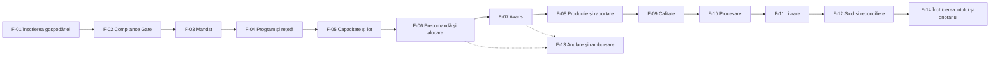
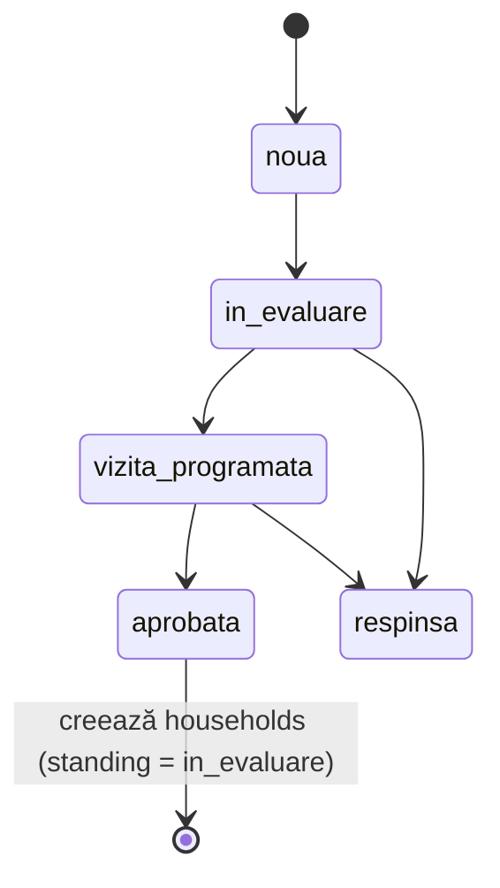
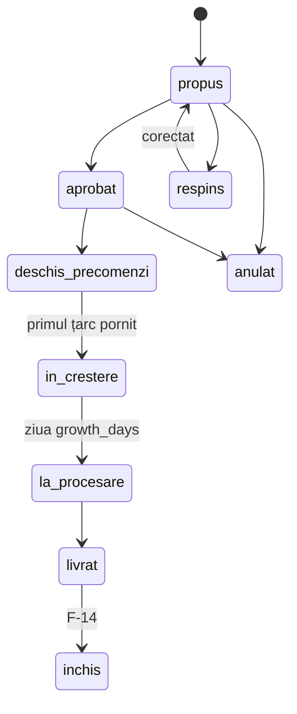
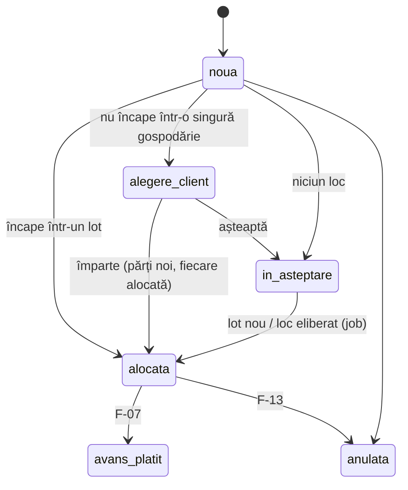

# CLAUDE — PUII MEI · 04 — Fluxurile operaționale cap-coadă

**Autor:** Claude Code · **Data:** 23 noiembrie 2026 · **Versiune:** 0.1 (draft pentru comparație cu ChatGPT)
**Bază:** CLAUDE-02 v0.2 (tabele, invariante INV-xx, erori §16), CLAUDE-03 (permisiuni, separarea atribuțiilor),
CLAUDE-VERIFICATION-V1, `00-SYSTEM-CONSTITUTION.md`, `01-BUSINESS-ARCHITECTURE.md` (F1–F5, lifecycle), ADR-001.
**Convenții:** **[CONFIRMAT]** · **[PROPUS]** · **[DESCHIS]** · **[COD]** = există azi. Fluxurile reglementate (bani,
sacrificare, transport, contracte) rămân **blocate pentru implementare** până la închiderea deciziilor marcate [DESCHIS].

---

## Harta fluxurilor

Fiecare flux are aceeași structură: **scop · actori · precondiții · stări · pași (cu tranzacții) · excepții · date ·
permisiuni · API · evenimente · teste · criterii de acceptanță**. Codurile de eroare sunt cele din CLAUDE-02 §16.

---

## F-01 — Înscrierea gospodăriei

**Scop:** de la cererea „Devino partener” la o gospodărie înregistrată, cu titular și cont. [CONFIRMAT ca direcție,
BA §5]; azi: formular + creare profil din admin [COD].

**Actori:** solicitant (public), manager operațional, admin platformă.
**Precondiții:** —.

**Stări (`platform.applications.status` → `household.households.standing`)**

| Pas | Cine | Ce se întâmplă | Tranzacție / evenimente |
|---|---|---|---|
| 1 | solicitant | trimite formularul (date de contact, localitate, suprafață estimată, experiență) | insert `applications`; `application.submitted`; limită de rată + capcană |
| 2 | operațional | evaluează, programează vizita, notează | update status; audit |
| 3 | operațional | aprobă → creează **entitatea economică** (formă juridică [DESCHIS BA-001], date fiscale) + **profilul public** (nepublic încă) + invitația titularului | o tranzacție: `households` + `farm_profiles(is_public=false)` + `users(invitat)` + `memberships(gospodar)` + `invitations`; `household.created` |
| 4 | titular | activează contul (parolă; MFA recomandat) | `users.status = activ` |

**Excepții:** email deja folosit → contul existent primește membership nou (ADR-006); solicitare duplicată (același
telefon / localitate) → avertizare operatorului, nu blocare.
**Permisiuni:** `household.create` (Op cu aprobarea Adm: CLAUDE-03 §5.2).
**API:** `POST /public/applications`, `POST /applications/{id}/approve`.
**Teste:** formularul public peste limită → 429; aprobarea creează toate cele 5 înregistrări sau niciuna (rollback);
profilul nou nu apare pe site până la F-02.
**Acceptanță:** o gospodărie nouă există cu titular invitat, fără să poată primi loturi sau comenzi.

---

## F-02 — Compliance Gate

**Scop:** nicio activitate comercială înainte ca cerințele obligatorii să fie dovedite și verificate. [PROPUS — obligatoriu
înainte de activare, SC-043]; azi nu există [COD: CX-08].

**Actori:** titular (încarcă dovezi), calitate (verifică), admin (activează).
**Precondiții:** F-01; catalogul `compliance_requirements` populat pentru program [DESCHIS: lista reală de cerințe, de la
DSVSA / jurist / contabil]. Exemple de cerințe: act de proprietate / folosință teren, înregistrare sanitar-veterinară,
contract de administrare, cont bancar, forma juridică, contabil desemnat.

**Stări per cerință (`compliance_checks.status`):** `lipsa → in_verificare → valid | respins`; `valid → expirat`
(job zilnic pe `expires_at`). **Stare agregată** (`households.compliance_status`): `valid` doar dacă toate cerințele
obligatorii sunt `valid`.

| Pas | Cine | Ce se întâmplă | Tranzacție / evenimente |
|---|---|---|---|
| 1 | titular | încarcă documentul pentru o cerință | `documents` + `compliance_checks.status = in_verificare`; fișierul nu se servește până e scanat (INV-13) |
| 2 | calitate | verifică: valid (cu dată de expirare) / respins (cu motiv) | update + recalcul agregat; `compliance.gate_changed` |
| 3 | sistem | când agregatul devine `valid` → gospodăria poate fi activată (`standing = activa`, profil public) | `household.standing_changed` |
| 4 | job | expirarea unei cerințe → agregat `expirat` → **blocare**: fără loturi noi și fără alocări noi; loturile în curs continuă, cu alertă | `compliance.gate_changed` |

**Excepții:** document ilizibil → `respins` cu motiv; cerință neaplicabilă → marcată de calitate cu justificare.
**Permisiuni:** `household.compliance.check` (Cal), încărcare (Gsp); activare (Adm / Op cu aprobare).
**API:** `POST /households/{id}/compliance/{requirementCode}/evidence`, `POST /compliance-checks/{id}/decide`.
**Teste:** INV-08 — gospodărie cu o cerință `lipsa` / `expirat` → `production.createLot` și `reserveCapacity` →
`COMPLIANCE_BLOCKED`; trecerea la `valid` deblochează.
**Acceptanță:** nicio gospodărie nu poate primi comenzi fără toate cerințele obligatorii valide; istoricul verificărilor
e complet.

---

## F-03 — Mandatul PUII MEI

**Scop:** limitele în care PUII MEI acționează în numele gospodăriei. [DESCHIS BA-002 / DEC-001]: forma, conținutul și
ce poate semna / plăti PUII MEI. **Implementarea e blocată până la validarea juridică și bancară.**

**Stări:** `ciorna → semnat → activ → revocat | expirat`.
**Reguli [PROPUS]:** fiecare acțiune PUII MEI în numele gospodăriei verifică un mandat activ care conține scopul
acțiunii (ex. `documente`, `comenzi`, `plati_furnizori`) și limitele (ex. plafon); revocarea are efect imediat
(acțiunile în curs se opresc la următorul pas) și e notificată.
**Teste:** mandat revocat → acțiune PUII MEI în numele gospodăriei → `ACCESS_DENIED` (CLAUDE-VERIFICATION-V1 §2.1 test 8).
**Acceptanță:** nicio operațiune în numele gospodăriei fără mandat activ și în scop.

---

## F-04 — Programul și rețeta versionată

**Scop:** parametrii de producție și costurile standard ale unui program (ex. „Pui pășunat 60 de zile”) sunt definite,
versionate și aprobate; gospodăria se înscrie în program.

**Stări (`program_versions`):** `ciorna → aprobata → activa → inlocuita`. O versiune aprobată nu se mai modifică (se
creează alta). Loturile păstrează versiunea cu care au pornit (INV-10 extins).

| Pas | Cine | Ce se întâmplă |
|---|---|---|
| 1 | operațional / calitate / financiar | redactează parametrii (`params`, validați cu schema verticalei) și costurile standard (`cost_standards`) |
| 2 | admin (MFA) | aprobă versiunea; `program.version_approved` |
| 3 | operațional | înscrie gospodăria (`household_programs`: `propus → eligibil → activ`), după F-02 |

**Reguli:** parametrii zootehnici (randamentul la sacrificare, FCR) au statut de validare; **costul standard al furajului
rămâne gol** până la validarea zootehnică (CLAUDE-VERIFICATION-V1 §3, ADR-008).
**Teste:** modificarea unei versiuni aprobate → refuz; un lot vechi își păstrează parametrii după aprobarea unei versiuni
noi; schema verticalei respinge parametri lipsă / invalizi.
**Acceptanță:** orice calcul (capacitate, avans, buget, onorariu) indică versiunea folosită.

---

## F-05 — Capacitatea și lotul

**Scop:** din suprafața verificată → numărul de țarcuri → lotul propus de gospodar și aprobat. [COD] în mare parte
(suprafață, țarcuri de 40, lot propus / aprobat, cod MS-2026-01, un lot pe rând, limite).

**Precondiții:** gospodăria `activa`, Compliance Gate valid, înscrisă în program, suprafață verificată.

**Stări (`production.lots.status`)**

| Pas | Cine | Ce se întâmplă | Reguli |
|---|---|---|---|
| 1 | calitate / operațional | verifică suprafața (`verified_m2`) | țarcuri = ⌊m² / 170⌋ (parametru de program) |
| 2 | gospodar | propune lotul: data de pornire, nr. de țarcuri (≤ maximul) | cod = prefix localitate + an + nr. (MS-2026-01); „un lot pe rând” dacă programul o cere; limite anuale / pe lot; fără blocaj de calitate activ |
| 3 | operațional | aprobă / respinge cu motiv | creează țarcurile (`pens`, capacitate 40); `lot.approved` → lotul intră la precomenzi |

**Excepții:** suprapunere cu alt lot (când „un lot pe rând”) → refuz cu motiv; peste limită → refuz; regim
suspendat → `COMPLIANCE_BLOCKED`.
**Permisiuni:** `production.lot.propose` (Gsp), `approve` (Op); `household.land.verify` (Cal / Op).
**API:** `POST /lots`, `POST /lots/{id}/approve`, `POST /lots/{id}/reject`.
**Teste:** [COD] testele E2E existente pentru suprafață și țarcuri; + refuz la suprapunere, limită și regim.
**Acceptanță:** lotul aprobat are țarcuri, versiunea de program și codul unic.

---

## F-06 — Precomanda și alocarea

**Scop:** clientul comandă fără să aleagă lotul; sistemul rezervă capacitate pe țarcuri; dacă nu încape într-o
gospodărie, clientul alege împărțirea sau așteptarea. [CONFIRMAT de PO], [COD].

**Precondiții:** zona activă; preț valid; cel puțin un lot deschis (altfel comanda intră în așteptare).

**Stări (`commerce.orders.status`)**

| Pas | Ce se întâmplă (o tranzacție, cheie de idempotență) |
|---|---|
| 1 | validare (Zod) + limită de rată + acceptarea termenilor (versiunea `terms_version`) |
| 2 | creează / găsește `customer`; creează `order` + `order_line` cu **prețul înghețat** (`price_list_id`, `unit_price_bani`) — INV-10 |
| 3 | alocare: caută primul lot deschis (gospodărie activă, Compliance Gate valid, fără blocaj) în care încape **toată** cantitatea; pentru fiecare țarc: `SELECT … FOR UPDATE`, calculează locul liber, inserează `allocations` (INV-01) |
| 4 | dacă nu încape: `alegere_client` (cu maximul care încape într-o singură gospodărie) sau `in_asteptare` |
| 5 | acces 24 h pentru dispozitivul clientului; `order.placed` / `order.allocated` → notificări, instrucțiunile de plată (F-07) |

**Excepții:** retry cu aceeași cheie → același rezultat (INV-02); aceeași cheie cu alt conținut → `IDEMPOTENCY_CONFLICT`;
ultimul loc luat între timp → se încearcă următorul lot, altfel `alegere_client` / `in_asteptare` (fără eroare pentru
client); zonă inactivă → `INVALID_INPUT`.
**Permisiuni:** plasare publică; alocare manuală Op; alegerea împărțirii — clientul (O).
**API:** `POST /orders` (`Idempotency-Key`), `POST /orders/{nr}/choice` (`split` | `wait`).
**Evenimente:** `order.placed`, `order.allocated`, `order.waiting`.
**Teste:** INV-01 (10 cereri simultane pe ultimele locuri → nicio supra-vânzare; dovedit în SQL), INV-02, împărțirea
creează părți care însumează cantitatea inițială, comanda în așteptare se alocă automat la crearea unui lot.
**Acceptanță:** suma alocărilor pe țarc ≤ capacitate în orice moment; fiecare comandă e într-o stare definită.

---

## F-07 — Avansul (pui de o zi + furaj), în contul gospodăriei

**Scop:** clientul plătește avansul **direct gospodăriei** (SC-041, BA F1); plata se confirmă doar cu dovadă (SC-017).
[COD] parțial: IBAN-ul gospodăriei, „Am făcut plata”, confirmare prin click (CX-04).

**Stări (`finance.payments.status`):** `asteptata → declarata_client → confirmata`; `asteptata / declarata_client →
respinsa` (sumă / referință greșită) sau `anulata` (comanda anulată); expirare la N zile fără plată [DESCHIS: termenul].

| Pas | Cine | Ce se întâmplă |
|---|---|---|
| 1 | sistem | la alocare: creează `payments(kind = avans, status = asteptata)` cu **referință unică** de plată și suma = pui × (preț pui de o zi + furaj / pui × preț furaj) din versiunea programului și prețurile gospodăriei; afișează IBAN-ul gospodăriei |
| 2 | client | „Am făcut plata” → `declarata_client` (nu e dovadă) |
| 3 | gospodar (beneficiar) sau mandatar autorizat | confirmă cu **referința extrasului / OP**, data și suma primită → `payment_confirmations` + `confirmata` (INV-04) |
| 4 | sistem | `payment.confirmed` → comanda `avans_platit`; registrul gospodăriei primește venitul „avans” (ciornă, de confirmat cu documentul) |

**Excepții:** sumă diferită → confirmare cu diferența marcată (`reconciliation_exception`), decizie manuală; plată fără
referință → potrivire manuală de financiar; dublă confirmare → respinsă (INV-03 / unicitate pe referință).
**Permisiuni:** declarare (Cli, O); confirmare (Gsp, H; Fin doar cu mandat; MFA); AI — niciodată.
**API:** `POST /payments/{id}/declare`, `POST /payments/{id}/confirm`.
**Teste:** INV-03, INV-04; confirmarea de către client → 403; de către agent AI → 403.
**Acceptanță:** nicio comandă nu trece la „avans plătit” fără o confirmare cu referință bancară.
**[DESCHIS]:** termenul de plată și ce se întâmplă la neplată (eliberarea locului?); integrarea cu extrase bancare.

---

## F-08 — Producția și raportarea

**Scop:** de la pornirea țarcului până la ziua de sacrificare, cu efectivul, jurnalul și alertele. [COD] parțial
(pornire țarc, jurnal cu GPS, poză la 7 zile, alerte); efectivul cu evenimente și cântăririle sunt [SPEC].

| Pas | Cine | Ce se întâmplă | Reguli |
|---|---|---|---|
| 1 | gospodar | pornește țarcul când e plin (40 rezervați) | toate țarcurile lotului în max. 7 zile de la primul (INV-09); `flock_events(intrare, 40)` + `pens.started_at`; `pen.started` |
| 2 | gospodar / membru | zilnic de la ziua 21: „Am mutat țarcul” (GPS) | `growth_entries(mutare)` |
| 3 | gospodar / membru | la ≤ 7 zile: poza săptămânii; oricând: hrănire, apă, tratament, veterinar (cu numele medicului) | append-only |
| 4 | gospodar / membru | mortalitate: număr + cauză + poză | `flock_events(mortalitate)`; efectivul scade; dacă efectivul < alocări → excepție (mai jos) |
| 5 | gospodar | cântărire pe eșantion (recomandat la zilele 21, 42, 56) | `weighings` |
| 6 | job zilnic | alerte: țarc nemutat ≥ 2 zile, poză lipsă > 7 zile, mortalitate peste prag [DESCHIS: pragul] | `monitoring_alerts`; `monitoring.alert_raised` → admin + gospodar |
| 7 | client | vede jurnalul lotului lui, traseul țarcului, poza săptămânii | vederi de trasabilitate (O) |

**Excepția importantă — mortalitate peste rezervări:** când efectivul unui țarc scade sub suma alocărilor, comenzile
afectate se tratează după o regulă [DESCHIS BA-007]: propun ordinea inversă a plasării (ultimele comenzi primesc mai
puțini pui), cu notificare și ajustarea avansului / rambursare (F-13).
**Permisiuni:** CLAUDE-03 §5.4 (corecția efectivului cere aprobare).
**API:** `POST /pens/{id}/start`, `POST /lots/{id}/growth-entries`, `POST /pens/{id}/flock-events`, `POST /pens/{id}/weighings`.
**Teste:** pornirea în afara ferestrei → refuz; corecția efectivului fără aprobare → refuz; alertele se ridică și se
închid; clientul nu vede lotul altui client.
**Acceptanță:** în orice zi, efectivul fiecărui țarc = suma evenimentelor; fiecare alertă are rezolvare sau e deschisă.

---

## F-09 — Calitatea și conformitatea pe lot

**Scop:** verificări, neconformități, acțiuni corective și **blocarea lotului** (SC-020). [SPEC]; azi: evaluări ale
clienților [COD].

| Pas | Cine | Ce se întâmplă |
|---|---|---|
| 1 | calitate / veterinar | inspecție (`inspections`): conform / neconform / observații, cu raport |
| 2 | oricine (gospodar, client prin reclamație, monitorizare) | semnalează o neconformitate (minoră / majoră / critică) |
| 3 | calitate | la majoră / critică: **blochează lotul** (`lot_holds`): fără alocări noi (INV-07), fără plecarea în livrare |
| 4 | responsabil | acțiune corectivă, cu dovadă |
| 5 | calitate (+ al doilea aprobator la critică) | închide neconformitatea și deblochează lotul (MFA) |

**Excepții:** blocaj în timpul unei ture → coletele lotului nu se încarcă; cele deja încărcate → retur [DESCHIS:
procedura cu DSVSA].
**Teste:** INV-07; deblocarea fără al doilea aprobator pe „critic” → refuz; AI nu poate debloca.
**Acceptanță:** niciun produs dintr-un lot blocat nu ajunge la client.

---

## F-10 — Procesarea (sacrificarea)

**Scop:** sacrificarea ca etapă trasabilă. **[DESCHIS BA-003 / DEC-004]:** unde (în gospodărie sau unitate
autorizată), de cine, cu ce autorizare. **Implementarea e blocată până la validarea DSVSA.**

**Pași [PROPUS]:** la ziua `growth_days`: verificare (fără blocaj, efectiv confirmat) → înregistrare `processing_runs`
(data, locul, operatorul, nr. păsări, kg carcasă total, temperatura) → `flock_events(sacrificare)` → răcire 0–4 °C
[COD: parametru; DESCHIS: validare] → cântărirea **pe colet** pentru prețul final → etichete (F-11).
**Teste:** nr. păsări sacrificate ≤ efectiv; temperatură în afara intervalului → neconformitate automată.
**Acceptanță:** fiecare colet are legătură cu sacrificarea, lotul și țarcul.

---

## F-11 — Livrarea

**Scop:** de la etichetă la confirmarea primirii. [COD] (etichete QR, ture, traseu, PIN-uri curier, poze, temperatură,
semnătură, confirmare, evaluare, prelungiri aprobate).

**Stări colet:** `etichetat → incarcat → predat → confirmat`; **stări tură:** `planificata → in_curs → incheiata |
anulata`.

| Pas | Cine | Ce se întâmplă |
|---|---|---|
| 1 | gospodar | generează etichetele (QR client + QR curier, termen de consum) |
| 2 | gospodar | creează tura (coletele, data, durata), traseul optimizat sau manual, PIN de ridicare |
| 3 | curier | se împerechează (link + PIN), încarcă coletele (poză, temperatură) |
| 4 | curier | predă (temperatură, poză, semnătură, GPS) |
| 5 | client | confirmă primirea (verificări, poze) în 12 h; evaluează în 7 zile |
| 6 | curier / admin | prelungirea turei: cerere cu motiv și poză, decizie admin |

**Excepții:** client absent → retur sau a doua încercare [DESCHIS]; temperatură peste 4 °C → neconformitate (F-09);
PIN greșit de 5 ori → tura blocată (de reparat V-02: operație atomică); colet nepredat la expirare → alertă.
**Teste:** [COD] E2E pentru flux; + V-02; curierul turei A nu atinge colete din tura B.
**Acceptanță:** fiecare colet predat are temperatură, dovadă și confirmare sau termen expirat.

---

## F-12 — Soldul final și reconcilierea

**Scop:** prețul final după greutatea reală, minus avansul confirmat; diferența plătită gospodăriei (BA F5). [DESCHIS]:
regula de calcul, ajustările, toleranțele.

**Pași [PROPUS]:** greutatea reală pe colet (`order_lines.final_weight_kg`) → total final = kg × preț înghețat + livrare
→ sold = total final − avans confirmat → `payments(kind = sold)` cu referință → plata la livrare / transfer →
confirmare cu dovadă (ca F-07) → venit în registrul gospodăriei (document fiscal emis de gospodărie).
**Excepții:** sold negativ (greutate mai mică decât avansul acoperă) → rambursare (F-13); diferență de greutate peste
toleranță [DESCHIS] → verificare.
**Teste:** calculul soldului pe exemple; nicio comandă „livrată” fără sold confirmat sau marcat ca excepție.
**Acceptanță:** fiecare comandă livrată are suma finală reconciliată cu plățile.

---

## F-13 — Anularea și rambursarea

**Scop:** ce se întâmplă când clientul anulează sau când gospodăria nu poate livra. **[DESCHIS BA-007]**, plus nota din
sugestii (22 nov. 2026): dacă alt client preia comanda anulată (integral sau parțial), avansul se poate rambursa integral
sau proporțional.

| Caz | Regula actuală / propusă |
|---|---|
| Anulare înainte de confirmare | gratuită [COD] |
| Anulare după alocare, înainte de avans | [PROPUS] gratuită; locul se eliberează (`allocations.status = eliberat`), comenzile în așteptare se realocă |
| Anulare după avans | [DESCHIS] rambursare integrală dacă locul e preluat de alt client, proporțională dacă e preluat parțial, altfel [DESCHIS] (puii și furajul sunt deja cumpărați) |
| Gospodăria nu poate livra (mortalitate, blocaj) | [PROPUS] rambursare integrală a părții nelivrate, din contul gospodăriei; notificare |

**Pași:** cerere → calculul propus după regula versionată → aprobare (financiar, MFA) → plata rambursării de către
gospodărie (cu dovadă) → corecție în registru.
**Teste:** eliberarea locului realocă automat comenzile în așteptare; rambursarea fără aprobare → refuz.
**Acceptanță:** fiecare anulare are regula aplicată, suma și dovada plății.

---

## F-14 — Închiderea lotului și onorariul

**Scop:** după livrarea și reconcilierea tuturor comenzilor lotului: venituri, cheltuieli, diferență, onorariu PUII MEI
= **10% × max(0, venituri − cheltuieli)** [CONFIRMAT ADR-001]. **Definițiile veniturilor și cheltuielilor sunt [DESCHIS];
formula nu se implementează executabil până la aprobarea lor.**

**Stări (`finance.lot_closings.status`):** `calcul → verificat_gospodar → aprobat → facturat`; `verificat_gospodar →
contestat → calcul`.

| Pas | Cine | Ce se întâmplă |
|---|---|---|
| 1 | sistem | precondiții: toate comenzile lotului livrate / anulate și reconciliate; toate înregistrările din registrul lotului confirmate (fără ciorne) |
| 2 | sistem | calculează după `rules_version`: venituri, cheltuieli (reale sau standard + abateri, după ADR-001), diferență, onorariu; fiecare linie legată de document |
| 3 | gospodar | verifică și acceptă sau contestă (cu motiv) |
| 4 | financiar (MFA; alt om decât cel care a confirmat registrul) | aprobă |
| 5 | financiar | emite factura de servicii către gospodărie; gospodăria plătește din contul ei (BA F4) |

**Excepții:** comenzi nereconciliate → închiderea nu pornește; contestare → recalcul cu documentele noi.
**Teste:** INV-11 (o singură închidere / lot); exemple: diferență pozitivă → 10%; zero sau negativă → 0; separarea
atribuțiilor (CLAUDE-03 §6).
**Acceptanță:** onorariul fiecărui lot are calculul complet, dovezile și acceptarea gospodarului.

---

## Matricea flux × module

| Flux | identity | household | program | production | inventory | commerce | contracts | finance | logistics | quality | notifications |
|---|---|---|---|---|---|---|---|---|---|---|---|
| F-01 | ● | ● | | | | | | | | | ● |
| F-02 | | ● | ○ | | | | | | | ● | ● |
| F-03 | | ● | | | | | ● | | | | ● |
| F-04 | | ○ | ● | | | | | ○ | | ○ | |
| F-05 | | ● | ● | ● | | | | | | ○ | ● |
| F-06 | ● | ○ | ○ | ● | | ● | ○ | | ○ | ○ | ● |
| F-07 | | ○ | ○ | | | ● | | ● | | | ● |
| F-08 | | | ○ | ● | ● | ○ | | | | ○ | ● |
| F-09 | | ○ | | ● | | ○ | | | ○ | ● | ● |
| F-10 | | | ○ | ● | | | | | ● | ● | |
| F-11 | ● | | | ○ | | ● | | | ● | ○ | ● |
| F-12 | | | | | | ● | | ● | ○ | | ● |
| F-13 | | | | ○ | | ● | ○ | ● | | | ● |
| F-14 | | ○ | ● | ● | ○ | ○ | | ● | | | ● |

● modulul deține pasul · ○ modulul e consultat / afectat.

## Decizii deschise care blochează fluxurile

| Flux | Blocat de |
|---|---|
| F-01 | BA-001 (forma juridică) |
| F-02 | lista reală de cerințe de conformitate (DSVSA, jurist, contabil) |
| F-03 | BA-002 / DEC-001 (mandatul) |
| F-04 | ADR-008 (FCR, randament) pentru costul standard al furajului |
| F-07 | termenul de plată, neplata, integrarea bancară |
| F-08 | pragul de mortalitate; regula la mortalitate peste rezervări (BA-007) |
| F-10 | BA-003 / DEC-004 (sacrificarea) |
| F-11 | BA-006 (transportul), procedura de retur |
| F-12 | regula soldului, toleranța la greutate (BA-008) |
| F-13 | BA-007 (anulare, rambursare) |
| F-14 | definițiile ADR-001 |

## Criterii de acceptanță ale documentului

- [ ] Fiecare flux are stări, pași, excepții, permisiuni, API, evenimente și teste (14 / 14).
- [ ] Fiecare acțiune din cod (26 de fișiere de acțiuni, auditul V1) aparține unui flux.
- [ ] PO confirmă regulile [PROPUS] și închide deciziile din tabelul de mai sus, în ordinea pilotului.
- [ ] Varianta ChatGPT (02 Operational Architecture) e comparată; diferențele se rezolvă prin ADR.
